# DOOM Engine Remaster Project - DERP

## A few thoughts

The technically correct name would be *Remaster Project for DOOM Engine
Games*, but RPFDE is a terrible acronym, so DERP it is. Up to v0.4.5 the
project was called Duct-Tape DOOM.

It has grown well past what I first had in mind. The original idea is
described further down and still holds. Along the way I found that what I
enjoy most is working out what these places were meant to look and feel like,
and what the hardware of the time kept them from doing.

My work on Doom, Doom II and Heretic is opinionated. I try to add only what
the original maps, artwork or game logic already suggest, and then take those
hints seriously.

I treat DERP as a creative project. Code is one of the tools I use to build
it. I'm glad to hear whether it works, whether it's fun and whether it does
what it sets out to do. How much of the code I typed myself is a different
question, and one the project isn't trying to answer.

DERP is a hobby project and development happens privately. The public
repository holds the versions I choose to release, without my ongoing
experiments or unfinished work. I sometimes show upcoming features on
YouTube; they reach the repository when I'm ready to release them.

### Forks and contributions

The GPL gives you every right to fork DERP, and I respect that. If you mainly
want to fix bugs, improve performance or extend existing features, I'd prefer
a pull request to another distribution of essentially the same project.
Improvements developed together reach more people.

## What this is

An idea of how DOOM could have looked if id had kept iterating on this engine,
and if we still played on CRTs. It tries to look newer without looking modern.

Under the hood it is a port of id Software's 1997 DOOM source release to
Windows, macOS and Linux, with an optional GPU renderer that builds a 3D scene
from the loaded WAD while the game runs.

Everything the renderer adds is worked out from the original artwork, maps and
game state. It needs no replacement textures, models, authored lighting or
edited maps, so vanilla and limit-removing WADs get the effects without their
authors preparing anything. Sound works the same way. Every sound DOOM didn't
have, from a lamp's buzz to a window breaking, is synthesized by code when the
game starts, and where it plays is read from the map. The exceptions are
listed where they come up: one spoken word, the voices and cries of DERP
mode's monsters (generated with ElevenLabs), the kick's leg and the kneeling
soldiers' frames (generated with ChatGPT), the bundled SoundFont, and recorded soundtracks you supply
yourself.

Most effects are fake-modern: cheap tricks of the kind I liked in late-90s
games, chosen over the techniques a modern engine would use. Effects stay or
go based on how they look in the game, and the code is written for trying
ideas out quickly. It isn't meant as a reference engine or a library. I'd be
glad if some of the ideas end up in other projects.

Claude writes much of the code. I decide what DERP should do and how it should
look and sound, test the results in the game, and keep iterating until they
match what I had in mind. Without that workflow I wouldn't have the spare time
for a project like this.

The defaults are how I like to play. Nearly everything can be changed in the
settings panel, **F4**.

## At a glance

- **3D renderer** on SDL_gpu: Vulkan on Windows and Linux, Metal on macOS.
  Native resolution, any aspect ratio, mouse look and free aim, movement
  interpolated between game tics, optional MSAA and HDR output.
- **Classic renderer:** the original 320×200 software view is one setting away.
- **No asset pack:** the WAD's own textures, flats, sprites and palettes are
  the source material.
- **Compatibility:** vanilla and limit-removing maps with DEHACKED patches.
  SIGIL plays as episode 5 of The Ultimate DOOM.
- **Three ways to play:** Normal is DOOM's own game with DERP's look. DERP
  mode, the default, is where the experiments live: monsters that take cover
  and talk, a player who can crouch, slide and kick, slow motion that costs
  something, and DOOM's first episode at night in the rain. Phobos plays the
  first episode on a moon 22 km across, in vacuum.
- **Light:** the level is lit as one model by its own lamps, screens, windows
  and the light bouncing off them, baked when the level loads and re-baked
  when doors open or lamps get shot out. Monsters block light and cast real
  shadows.
- **Climate and weather:** rain, snow, sand, ash, fog, dry ice, nukage rain or
  a firestorm, at any hour, temperature and wind. The map's rooms are worked
  out at load, the wind blows through them, and blasts, footsteps and doors
  disturb what falls and lies.
- **Window glass** that reflects and shatters, **lights that can be shot
  out**, **lamps that blink** with DOOM's flickering sectors.
- **Combat:** wound holes that follow the animation, blood that runs down
  steps, ragdolls drawn back into sprites, gore, muzzle flashes and
  explosions in four styles.
- **Skies with depth:** painted mountains stand at their own distances, cloud
  skies get volumetric clouds, Doom II's city becomes buildings.
- **Sound:** room acoustics measured from the map, sound that finds its way
  round corners and through doors, headphone output through a measured head,
  and synthesized footsteps, sparks, breaking glass and ambience.
- **Music:** a SoundFont synth with the bundled GeneralUser GS bank, an OPL FM
  synth written from the chip's manual, the Mac's system synth, or recorded
  soundtracks (PlayStation, 3DO, the 2024 re-release's) from packs you own.
- **Heretic** runs as a second program on the same renderer and sound,
  tuned for its fantasy world.
- **Controls:** gamepads, gyro aim, rumble, rebinding, the Steam Deck.
- **For mappers:** a `DERPINFO` lump sets a map's weather, wind, hour, sun,
  distance fog and wall mirrors, or switches on Phobos physics. Other ports
  ignore it.
- **Not supported:** Boom, MBF21 and GZDoom maps, Hexen, DOOM 64, slopes, 3D
  floors, model packs, ray tracing and multiplayer.

The Windows build gets the most testing. The macOS and Linux builds compile in
CI and have had less real play.

## Download and play

Ready-to-play builds for Windows, macOS and Linux are on the
[Releases page](https://github.com/robongrui/derp/releases). Each includes
Freedoom, so it plays straight away.

Start the launcher: **DERP.exe** on Windows, **derp** on Linux, **Play
DERP.app** on the Mac. It lists the game WADs it finds in the `wads` folder
next to it, in `DOOMWADDIR` and `DOOMWADPATH`, and in DOOM and Heretic games
installed through Steam or GOG. Drop files on its window and each goes where
it belongs: game WADs to the games list, custom WADs and `.deh`/`.bex` patches
to the load list, soundtrack packs to the music, `.sf2` files to the
SoundFont. Its **Settings** page has the same options as F4. It works with a
gamepad.

[PLAY.md](PLAY.md) has the controls and more on the launcher and options.

The ambience is off by default (**F4 → Sound → Made-up sounds**), and quiet on
purpose when on; the music covers most of it. To hear the soundscape, turn the
music down or off in **Options → Sound Volume**.

## Ways to play

**F4 → Game → World → Gameplay** picks one of three. Switching restarts a
first-episode map; you keep what you carry.

### Normal

DOOM's own game. Every map looks the way DERP derives it from the WAD, sun and
all, and the rules are id's.

### DERP mode

The default, and where most of the experiments go. It is unfinished: parts are
rough, some are half-built, and any of it may change or go away between
releases. Its rules apply on the maps id made and are off in demos and
netgames.

**Monsters that think.** Soldiers work as squads with jobs. They take cover
behind the map's corners, kneel behind low walls and stand to fire over them,
move one at a time while the others cover, hold doorways, guard keys,
switches and the pickups they were placed around, and fall back or set
ambushes after a lost fight. Word spreads: a soldier who hears gunfire or sees
a friend leave readies the room. A director keeps the pressure in check and
backs off when you are picking them off. Imps hunt as a pack: one holds your
attention while another goes round, they climb, hop across nukage, jump
through any window they fit (shattering the glass), and some hang from the
ceiling in dark corners and drop on your back. Pinkies smell you and charge.
Skill levels change how sharply they aim and how fast they spot you.
`-derpai` turns the AI on in any mode, for testing.

**Monsters that talk.** Soldiers shout what they are doing, pass on what they
know, chat when they think they are alone, and die mid-sentence. Each keeps
its own voice. Imps hiss and screech. The cries, pain and death sounds ship
with the game in `derp-cries.wad`; the spoken lines are a separate download,
[`derp-voices.wad`](https://github.com/robongrui/derp/releases/tag/v0.8), placed beside the game WAD. Without it the soldiers only
cry out.

**A player with legs.** You run at Quake's pace, 320 units a second, a
little over half of Doomguy's 583, so monsters that walk at a man's pace have
a fair chance. **C** crouches, and crouching out of a run slides. **E** is a
low jump and **Q** a kick; out of a slide the kick becomes a sweep. Kicked
soldiers go down and get up again with a kip-up. With Gore on, a severed head
can be kicked about too.

**Slow motion that costs.** The hourglass beside the status bar holds four
charges. It runs down while the world is slow, a kill refills half a charge,
and a headshot or a kill while sliding refills a whole one. The right mouse
button is the shootslide: a slide out of a run into slow motion for one charge.
See [Slow motion](#slow-motion).

**Heads.** Shots hit the head where the current frame draws it. A pistol
headshot kills quietly and the victim doesn't cry out.

**Guns with jobs.** Bullets have their own speed, spread and falloff per gun,
and a round that kills carries on through the body.

**Looks picked by hand.** DOOM's first episode lies at night in a downpour,
with some windows broken before you arrive. See
[Rain, night and wear](#rain-night-and-wear).

**Rooms that ring as built.** Room tails are traced from the map's real walls
at level start, and far rooms are heard ringing through their doorways. See
[Room tails traced from the map](#room-tails-traced-from-the-map).

### Phobos

DOOM's first episode says it takes place on Phobos, a moon of Mars 22 km
across. Pick **Phobos** and the episode plays as if that were literally true.
It touches only the first episode (DOOM's or Freedoom: Phase 1's) and never
runs in demos or netgames.

Phobos pulls at 1/1700 of Earth's gravity, so walking doesn't work. Movement
keys give gentle hops that float for about twenty seconds, Use next to a wall
pushes you off along the floor, E jumps, and running fires the suit's
thrusters. Knockback and recoil are real; a barrel is 225 kg of
monopropellant. Every sector has an air pressure and air rushes out through
every opening: doors cycle as airlocks, a broken window vents a room, and
whatever isn't held down goes with the draft, monsters included. Outside is
vacuum under a black sky with Mars in it, and you and your rockets can climb
to about 900 m. Grav boots let you walk on ceilings, and **Guns turn you**
spins you into backflips.

**F4 → Game → Phobos** sets how much help you get (legs and guns only,
thrusters, or thrusters with grav boots), whether monsters wear mag boots,
and how hard decompression pulls. Mappers can switch Phobos on for their own
maps with `phobos = true` in [DERPINFO](DERPINFO.md).

See [`linuxdoom-1.10/p_phobos.c`](linuxdoom-1.10/p_phobos.c) and
[`linuxdoom-1.10/p_boots.c`](linuxdoom-1.10/p_boots.c).

## Heretic

DERP plays Raven's Heretic on the same 3D renderer, lighting, sound and music,
again worked out from the WAD. Pick a Heretic WAD in the launcher and it
starts the Heretic program, `derp-heretic`, which ships next to the DOOM one.
You need your own copy: the 2025 *Heretic + Hexen* release has both the new
`heretic.wad` and the original DOS `HERETIC.WAD`, and both work.

The effects are tuned for a fantasy world. There is no window glass and there
are no lamps to shoot out. The Torch item is the light you carry, burning as a
flickering flame, and the hero light is on faintly by default. Torches,
chandeliers and serpent statues light their rooms, stained glass glints and
throws its colours onto the floor, water is clear and mirror-like, the Ice
Grotto's floor gets glassy streaks, and gloss comes from each texture's
material. Episodes 4 and 5 get skies of their own: hanging tendrils that move
one by one, and dead trees in fog. Where Heretic already has a sound of its
own, such as its wind and waterfalls, the game's sound is used and DERP's is
left off.

Heretic has had far less play than DOOM. [`heretic/README.md`](heretic/README.md)
has its controls and what does and doesn't work yet.

## SIGIL

With The Ultimate DOOM loaded, John Romero's SIGIL (E5M1–E5M9) plays as
episode 5, with its own names, intermission and menu entry. Bring your own
`SIGIL.wad`.

## Episode 0.5: SCP_7179_B

It's in the episode menu when you play DOOM II, TNT or Plutonia, and it is the
one place where DERP brings a map of its own. That is all this README says
about it. [`scp_7179_b/README.md`](scp_7179_b/README.md) has how to start it
and the credits.

## Screenshots

<p>
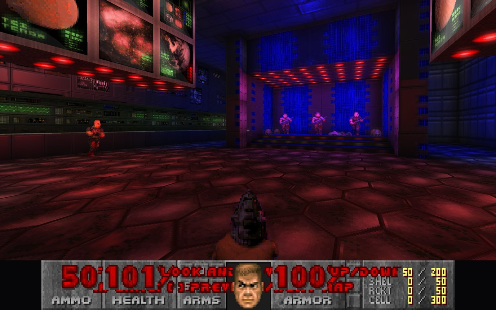
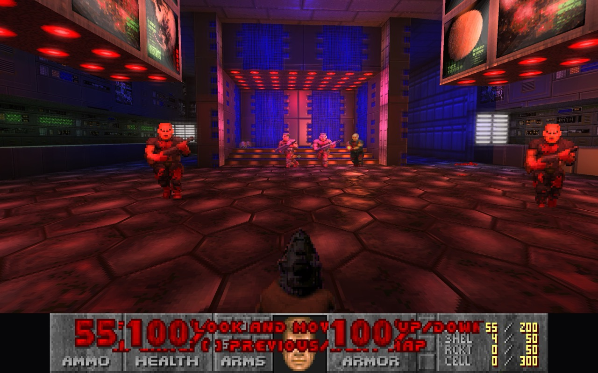
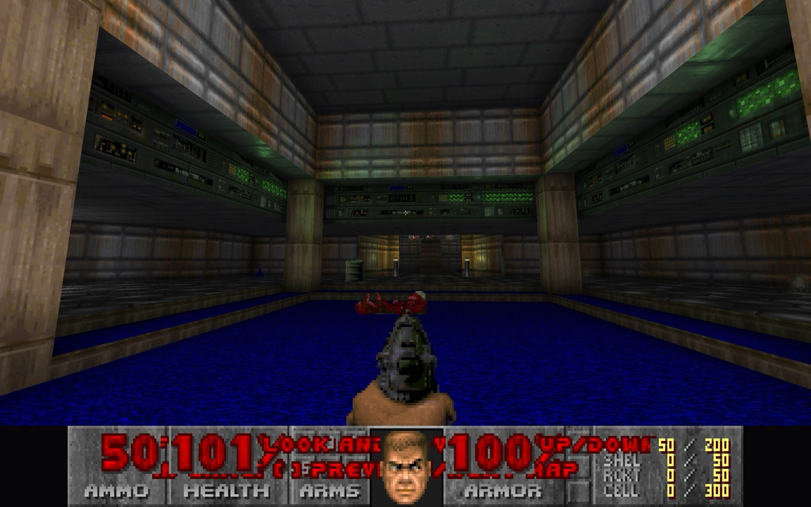
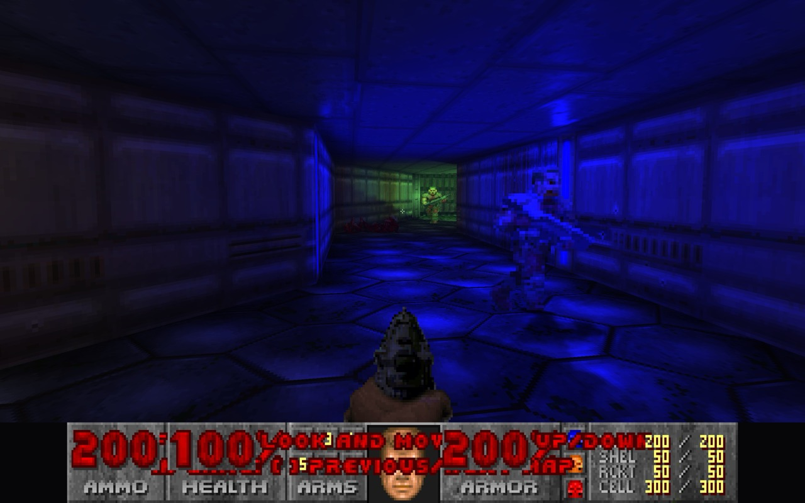
</p>

## The settings panel

**F4** opens the settings over the paused game. Options are sorted into four
groups (Game, Controls, Graphics and Sound), each with tabs, and the
highlighted option's description is shown at the bottom. Options that only
refine another are greyed out while it is off.

Options that cost frame time carry bars: one green, two yellow, three red,
measured on E1M1 and E1M2. Options that cost only in some places say where
(near windows, near liquids, under open sky, in fights). **F4 →
Graphics → Display → Preset** sets all of them at once and leaves matters of
taste alone:

| Preset | For |
| --- | --- |
| Lowest | Old or built-in graphics chips. Bump detail, bloom, fog, sky depth, reflections and monster shadows off; the light itself stays. |
| Handheld | The Steam Deck. Bloom, texel-aligned light and glass reflections off; monsters fall procedurally instead of as ragdolls. |
| Balanced | DERP as it comes. |
| High | Balanced with 2× anti-aliasing. |
| Everything | 4× anti-aliasing and half-resolution liquid reflections. |

**Show FPS** under Display has five levels. **Full** shows a frame-time graph,
CPU load, how frames reach the screen, the GPU, the version, the map and what
each running system costs, so a screenshot (F7) says what a bug report needs.
**Full, with GPU times** adds the GPU time of each part of the picture; it
waits on each part, so the game runs slower while it shows. The key left of
**1** steps through the levels while you play.

Settings are saved in `graphics.cfg`. Each option's key is listed beside it in
[`platform/settings_panel.cpp`](platform/settings_panel.cpp).

## What the graphics do

### Light comes from things that look like lights

DOOM hints at its lighting through sector brightness, glowing textures and
flats, decorations, windows and the shapes of rooms. The renderer turns those
hints into light sources.

Lamp strips, computer panels, lava and other glowing artwork are recognised by
texture name and palette colour. Their bright pixels become glow masks and
light sources. Wall panels shine mostly forward, so they don't light through
their own wall, and lamps close by light the walls beside them at a raking
angle. Computer walls dotted with a few LEDs light the room only as much as
those LEDs would. Torches, candles and other glowing decorations cast light
sized to their artwork.

A lamp lights as strongly as its sector's light level says. The level is the
mapper's stand-in for the lamp's brightness, so a strip set only a notch above
its room stays a dim fixture: the strength rises with the square of the level,
from nothing at 96 to full at 208. Floor paint the mapper lit like a fixture,
such as `FLOOR1_6`, glows too.

Windows and other openings to the sky let the outdoor light in. A barrel's
slime glows on top.

<p>
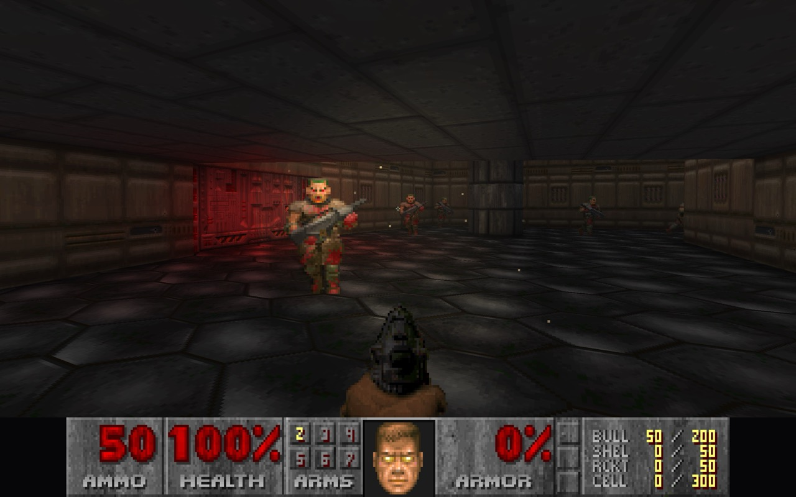
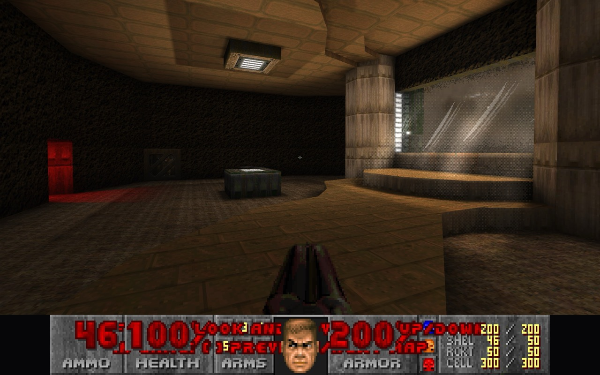
</p>

See
[`platform/scene3d/bake_lights.cpp`](platform/scene3d/bake_lights.cpp),
[`platform/emissive.h`](platform/emissive.h) and
[`platform/surface_lighting.h`](platform/surface_lighting.h).

### The whole level is lit as one model

**F4 → Graphics → Lighting → Lighting** offers two models.

**Whole level**, the default, lights the level by its own lights: lamps,
screens, windows, the sky and what bounces off them, each reaching as far as
real light does. DOOM's sector light levels no longer light the rooms. Light
spills from a bright room into the dark one next door, daylight reaches into
rooms through their openings, and a room whose lamps are shot out goes black.
It is still being built and is finished only for indoor areas so far.

Two sliders tune it. **Surfaces return light** sets how much light a surface
bounces on. DOOM's textures are painted dark, as if already in dim light, so
taken as drawn a floor returns about a quarter and bounce dies at once; the
default counts them twice as light. **Fill light** lets a room its own lights
don't reach keep some of the light level its mapper gave it. It is off by
default. **Light by logic** is a test that ignores the mapper's light levels
entirely: every lamp shines in full by its artwork and daylight follows the
hour.

**Classic** is DOOM's own light level per sector with the baked lamps,
windows and bounce on top. It has its own options for spilling light through
doorways, darkening rooms that their lamps light well (so the light seems to
come from the lamps), and tinting a room by the colour of its bounced lamp
light.

See [`platform/scene3d/light_rooms.cpp`](platform/scene3d/light_rooms.cpp),
[`platform/scene3d/room_fill.cpp`](platform/scene3d/room_fill.cpp) and
[`platform/scene3d/bake_bounce.cpp`](platform/scene3d/bake_bounce.cpp).

### Static light is baked when a level loads

The bake works on DOOM's 2D map and is far simpler than a modern lightmap.
It gathers light from lamps, glowing textures and liquids, decorations,
windows and the sky, with walls and closed portals blocking it. It adds
bounce, sky fill, sun shadows, ambient occlusion in corners and under ledges,
and shadows from decorations such as columns, trees and hanging bodies. The
result is snapped to the texture grid, so the light changes in steps of DOOM
texels.

Each wall texel and floor cell also stores the direction its light comes from,
in the way Half-Life 2 stored it. With **Bumps in all baked light** on, seams,
bricks and panel edges catch the baked light from the side it comes from and
fall into shade on the other.

Baking is fast enough to repeat. It runs on the graphics card by default (on a
Mac, whose processor is quicker at it, on the processor), stages whose inputs
haven't changed are taken from a cache on disk, and **Quick sky and bounce
bakes** trades a little evenness for several seconds on big outdoor maps.

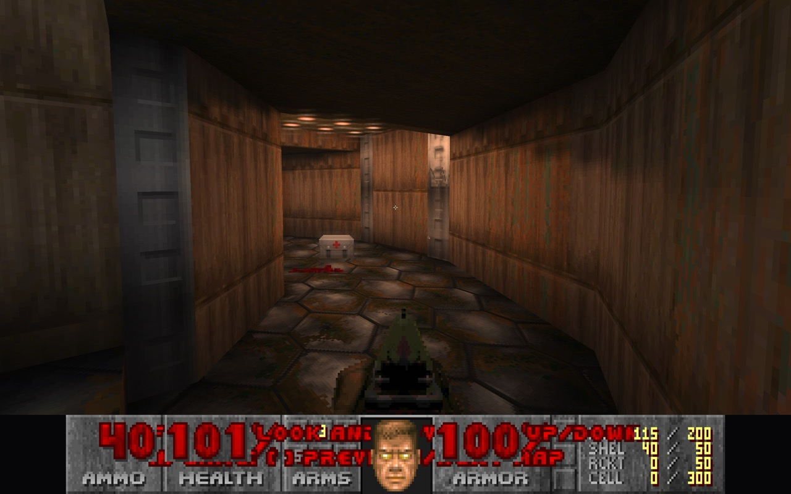

See
[`platform/baked_lighting.h`](platform/baked_lighting.h),
[`platform/scene3d/bake_basis.cpp`](platform/scene3d/bake_basis.cpp),
[`platform/scene3d/bake_cache.cpp`](platform/scene3d/bake_cache.cpp) and
[`platform/scene3d/relight.cpp`](platform/scene3d/relight.cpp).

### Light changes during play

Doors, lifts and lowering walls spill light through as they move. A door that
stays open, or a floor lowered for good, gets its light baked again in the
background once it stops. Doors that close again keep the spill only.

A lamp that is shot out takes its light with it. With **Shot-out light at
once**, the lamps near you are pre-baked as if already broken on helper
threads, so the room darkens on the frame the lamp breaks. It costs 50–150 MB
of memory. **Quick** uses three threads; **Gentle** uses two and dips the
frame rate about half as much. Re-bakes run on the graphics card by default,
or on the processor on a Steam Deck or a Mac.

A muzzle flash, a spark or an exploding barrel briefly lifts the light of the
room it goes off in, including the far side of a pillar but not the room next
door (**Flashes light the room**).

**Eye adaptation** meters the picture: a dim room opens up and its windows
burn out, and daylight reins it in.

**Hero light** (Off, Faint or Strong; off by default in DOOM) lifts what is
close to you and nearly black by a few steps, so you can make out walls and
monsters in the dark. Rooms lit by their own lights don't change, and nothing
shines, casts a shadow or glints from it.

See [`platform/scene3d/relight.cpp`](platform/scene3d/relight.cpp),
[`platform/scene3d/shot_lights.cpp`](platform/scene3d/shot_lights.cpp),
[`platform/scene3d/room_pulse.cpp`](platform/scene3d/room_pulse.cpp) and
[`platform/scene3d/exposure.cpp`](platform/scene3d/exposure.cpp).

### Per-frame light work can move into the bake

Lamps near the player can also run as live lights for flicker, bump and gloss
detail, and every monster and item can trace rays to the baked lights each
frame. Two switches move that work to level load:

- **Bake-only static lights** (Light sources): lamps and glowing textures stop
  being live lights. Their flicker, bump detail and gloss come from the bake,
  and lava and nukage pools glow as one light each. Shots, explosions and the
  flashlight stay live.
- **Grid lighting for monsters** (Shadows): monsters and items read static
  light from a grid baked after the lights, one sample every 32 units, with a
  second one higher up in tall rooms. They keep their per-pixel rounded
  shading.

See [`platform/scene3d/thing_light.cpp`](platform/scene3d/thing_light.cpp) and
[`platform/scene3d/lights.cpp`](platform/scene3d/lights.cpp).

### HDR

On an HDR display, **F4 → Graphics → Display → HDR** gives light brighter than
white the display's extra headroom: lamps, fire, muzzle flashes, plasma and
glowing pickups blaze while walls and the HUD look as in SDR. A view that is
mostly aglow stays near white, so a rocket in the face doesn't blind.
**HDR in the scene** lets lamp-lit walls, metal highlights and burned-out
daylight rise past white too, at some cost in GPU bandwidth. **HDR colours**
can stretch DOOM's colours toward the screen's wider gamut, as the Steam Deck
OLED does with every SDR game; Auto does that on the Deck only. Brightness and
highlight sliders sit below it. Screenshots stay SDR.

### Bump and gloss come from the original pixels

World textures need no normal maps or material definitions. The renderer reads
surface relief from the artwork. Broad brightness structure becomes panel
seams, mortar and grooves, and small noisy changes are softened, so a riveted
ceiling catches light along its seams while painted specks stay flat.

The palette ramps give a rough material guess. Greys and blues lean toward
metal and greens toward wet or polished surfaces; browns, flesh and most stone
colours stay fairly matte. **Varied highlights** gives smooth artwork tighter
reflections than busy artwork. **Metal shading** gives bare metal highlights
in its own colour, gold on brass and blue-grey on steel, and blank metal
plates a brushed sheen that runs the way the artwork's streaks do. None of it
is physically based. It exists to make the existing art react to light.

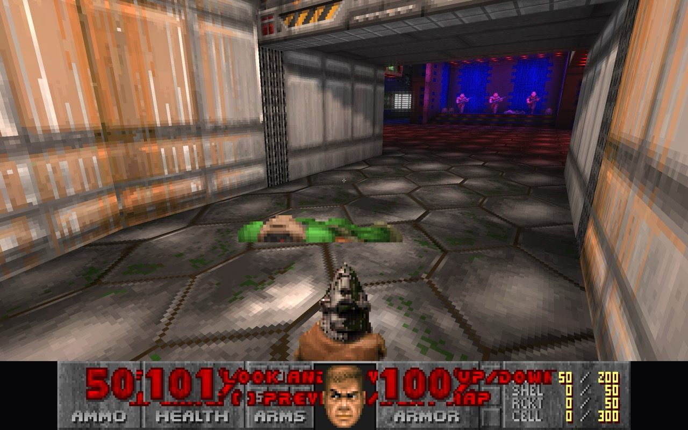

See
[`platform/scene3d/images.cpp`](platform/scene3d/images.cpp) and
[`platform/shaders/world.frag`](platform/shaders/world.frag).

### Tiles, bricks and wear

Under **F4 → Graphics → Surfaces**:

- **Uneven floor tiles:** tiles, plates and stones painted into floors each lie
  a little crooked, as if laid by hand. Lights catch some and miss others, and
  a thin lip lights up or falls into shadow where neighbours meet. **Uneven
  wall and ceiling tiles** does the same for ceilings and gives each wall brick
  its own tone.
- **Real-size bricks:** walls painted with DOOM's oversized two-metre bricks
  are laid again with bricks half the size, cut from their own artwork with
  the same mortar and bevels. Walls with windows, lights or mixed bricks keep
  their look.
- **Worn plates:** plain metal plates, such as the fronts of DOOM's computer
  desks, get grime in their seams, dull blotches, boot scuffs near the floor
  and a duller sheen.
- **Window streaks:** dark streaks run down outside walls below windows, rusty
  on metal. Inside they start once rain blows through a broken pane.

See [`platform/scene3d/relaid_walls.cpp`](platform/scene3d/relaid_walls.cpp),
[`platform/scene3d/wear.cpp`](platform/scene3d/wear.cpp) and
[`platform/shaders/world/wear.glsl`](platform/shaders/world/wear.glsl).

### The weapon sprite is de-lit and lit again

The weapon is still the original 2D sprite. Before drawing it, the renderer
takes out part of the broad light and painted sheen in the artwork and keeps
the outlines, detail and palette ramps. It builds rounded normals from the
silhouette and painted shading, and a gloss map from highlights and metal-like
colours.

The shader then lights the sprite from lamps, muzzle flashes and the room
around the player. Six directional probes stand in for the surroundings, so
bright walls and windows show up on glossy metal. DERP mode's kicking leg is
lit the same way, with a glossy boot. With partial invisibility your hands
turn to a spectre's fuzz.

See
[`platform/weapon_lighting.h`](platform/weapon_lighting.h) and
[`platform/scene3d/weapon.cpp`](platform/scene3d/weapon.cpp).

### Monsters are lit as rounded bodies

When a sprite loads, each pixel of its silhouette rises as a tube as wide as
the largest disc that fits inside the outline at that point. The torso becomes
a broad cylinder and arms, legs and guns thinner ones. Light falls on that
shape, and the painted shading stays visible on top. A monster's firing frames
are lit by the room like the rest of it; only the painted flash stays bright.

<p>
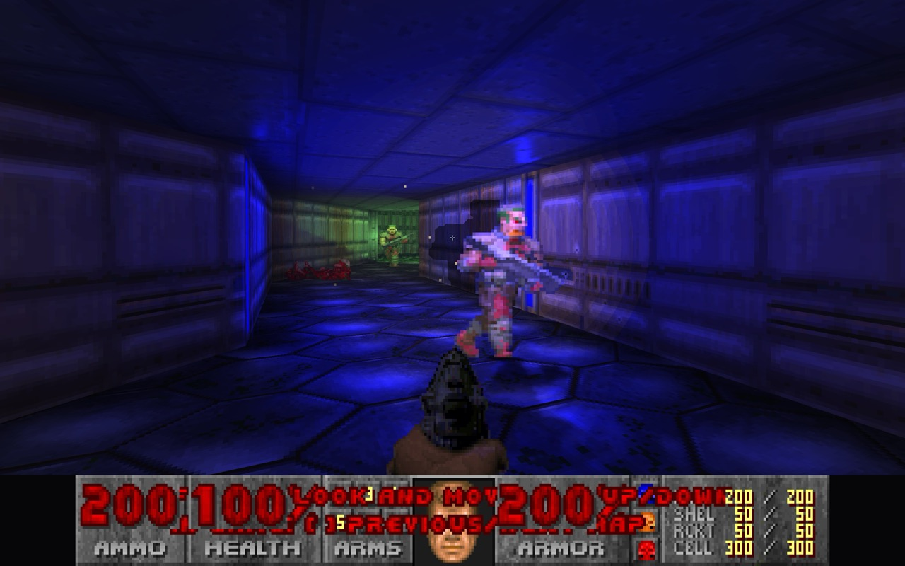
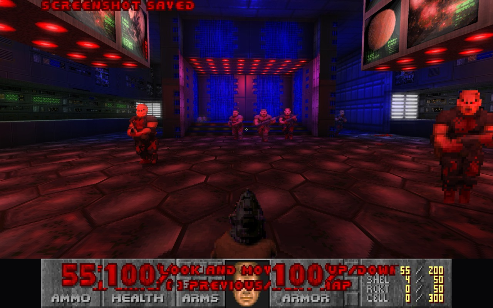
</p>

Monsters' eyes glow in the dark with a little bloom: the zombies' and imp's
red, the demon's yellow, the cacodemon's and mancubus's green, the
arachnotron's blue. For the stock DOOM and DOOM II monsters the glowing pixels
are picked by hand, frame by frame, so a monster turned away or squeezing its
eyes shut in pain shows none. Replaced artwork falls back to a search for eyes
painted in a colour the body never uses.

Sprites stand on solid floors instead of sinking into them.

See [`platform/scene3d/sprite_normals.cpp`](platform/scene3d/sprite_normals.cpp),
[`platform/sprite_eyes_stock.h`](platform/sprite_eyes_stock.h) and
[`platform/sprite_eyes.h`](platform/sprite_eyes.h).

### Shadows

With whole-level lighting, **Monsters block light**: each monster keeps the
light it stands in off the floor and walls behind it, in its own outline. The
lamp's, the sun's, a shot's and a fireball's light each cast their own shadow,
and a shadow is only that one light missing, so it fades into whatever is
already dark. Shadows that land nowhere the eye can see aren't drawn. Turned
off, or in classic lighting, a monster gets its current frame flattened onto
the floor as a dark decal, plus a second one pointing away from the strongest
light nearby.

Walls and ledges cast shadows in the flashlight and in shot light. **Soft shot
shadows** (on by default) makes muzzle flashes, projectiles and barrels shine
from a small body, so their shadows step with the artwork's pixels and soften
into a coarse dither at the edge. **Dithered shadow edges** (off by default)
does the same for the flashlight's shadows: a lit band, sparse dots,
checkerboard, dense dots, then shadow, pinned to the walls so it holds still
while the beam sways. On a CRT it blurs into something like a soft shadow.

The flashlight throws sprite silhouettes onto walls, and your own sprite casts
a shadow from the sun or the strongest light above you.

See [`platform/scene3d/shadows.cpp`](platform/scene3d/shadows.cpp),
`drawShadowVolumes` in [`platform/gpu3d/frame.cpp`](platform/gpu3d/frame.cpp)
and [`platform/shaders/shadow.frag`](platform/shaders/shadow.frag).

### The flashlight

**F** toggles it. It is mounted at the right shoulder, a little behind the
eyes as in Doom 3, so wall edges, door frames and things cast visible shadows.
It pulls back out of walls you are pressed against and sways with the weapon.

The classic beam, the default, brightens in DOOM's light-level steps. With
**Classic flashlight** off, the beam is longer and whiter and bounces a soft
light in the colour of what it hits. Dynamic light pushes saturated colours
toward its own hue, the way palette ramps brighten, so dark blue carpet shows
the beam.

The beam lights the weather. Flakes, drops and grains in it light up, it shows
as a cone in snow, sand and ash, fog and dry ice glow where it passes, and
lying snow and sand glitter from fixed facets on each grain.

See [`platform/scene3d/beam_air.cpp`](platform/scene3d/beam_air.cpp) and
[`platform/scene3d/lights.cpp`](platform/scene3d/lights.cpp).

### Shots and explosions

The colour of a dynamic light is sampled from the sprite that makes it. A
plasma shot casts blue light because the plasma sprite is blue, and the same
goes for weapon flashes, enemy attacks and glowing projectiles. Walls, doors
and raised floors block it.

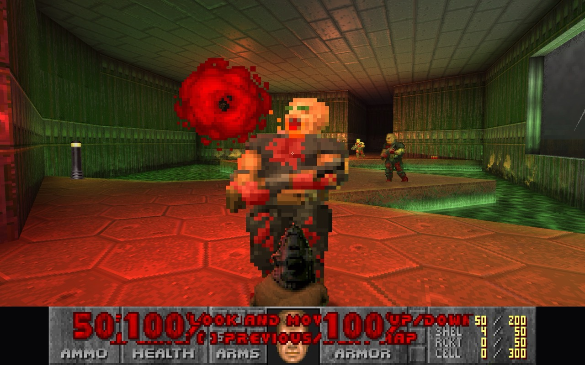

Under **F4 → Graphics → Combat → Shots**:

- **Muzzle flash:** bullet guns throw a burst of fire off the barrel, white to
  orange to dark red, gone in a few tics, and leave grey smoke that rises and
  thins. Each burst is a different shape. Enemies' fire starts where their
  firing frame paints its flash; yours replaces your gun's drawn flash, in its
  colours.
- **Explosions:** rockets and barrels go off in one of four ways.
  - *Doom's sprite* is the original.
  - *Doom-like* (the default) is a bigger fireball, never the same twice, with
    sparks, smoke, dust, a scorch and a light that lingers so what the blast
    throws casts a shadow. A barrel bursts into its own pieces.
  - *Physical* simulates the blast's hot gas in the room, so the room shapes
    it: up in the open, flat under a low ceiling, out through a doorway. Smoke
    stands in the room's own light. It costs a few milliseconds a tic while a
    blast lasts.
  - *Flashbulb* skips fireball and smoke: one tic of white light, a fill that
    fades and a few fast sparks, so you see what the blast did.
- **Bullet impacts:** shots throw what the wall is made of. Concrete gives a
  jet of dust that hangs, wood splinters, metal sparks at the mirror angle
  with a small light, machinery a rain of sparks and smoke. An enemy's shot
  near you is heard striking the wall.
- **Soft effect sprites:** explosions, puffs and teleport fog stop slicing
  into walls and dissolve on a dither at floors.

See [`platform/flash_lighting.h`](platform/flash_lighting.h),
[`platform/scene3d/muzzle_fire.cpp`](platform/scene3d/muzzle_fire.cpp),
[`platform/scene3d/explosions.cpp`](platform/scene3d/explosions.cpp) and
[`platform/scene3d/impacts.cpp`](platform/scene3d/impacts.cpp).

### Monitor textures get curved CRT glass

Computer textures are searched for dark rectangular screens framed by lighter
housing; vent grilles and similar shapes are rejected. No geometry is added.
The world shader puts a curved normal over the flat texture, bends the
picture a little like a weak lens, darkens the rim and lets dynamic lights
slide across the glass.

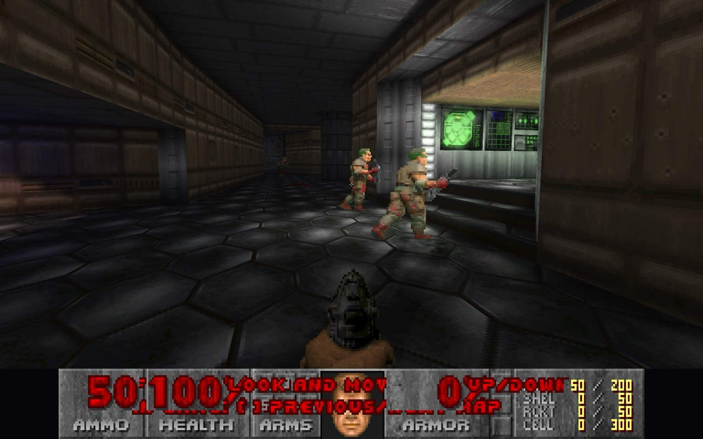

The same search finds blocks of glowing LED cells painted beside the screens,
such as the green grids on `COMPUTE2`. With **Live readouts**, those lamps run
a simple console blink loop: whole lamps snap on and off together, all out,
back in stages, all on.

See [`platform/screen_glass.h`](platform/screen_glass.h).

### Windows are found in the map and glazed

DOOM maps have plenty of windows and no glass. When a level loads, the
renderer looks for them in the geometry: a thin sector between two others,
with a sill, a lintel and solid jambs, that the player can't walk into. Lifts,
doors and anything a switch moves are skipped. The DOOM episodes have about a
hundred of these windows, DOOM II about eighty.

Each gets a mostly clear pane with grime at the frame and on the sill, a few
shine streaks painted the way Duke Nukem 3D did its glass, and sharp
highlights from lamps, muzzle flashes and the flashlight.

The game code doesn't know the glass is there. Shots, sight and movement pass
through as in vanilla, so the renderer watches for anything crossing a window.
The first two bullets leave small jagged holes with branching, pixel-stepped
cracks. The third starts a fracture that spreads across the pane. Projectiles
and explosions break it outright, yours or a monster's. The pane falls apart
into large irregular pieces that tumble, catch reflections, bounce and lie on
the floor for a while, leaving a jagged rim in the frame. Once a window is
broken, the wind and other sounds from outside come through it clearly.

<p>
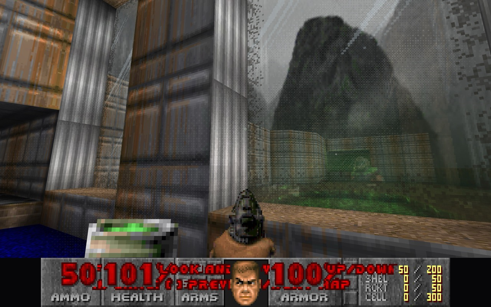
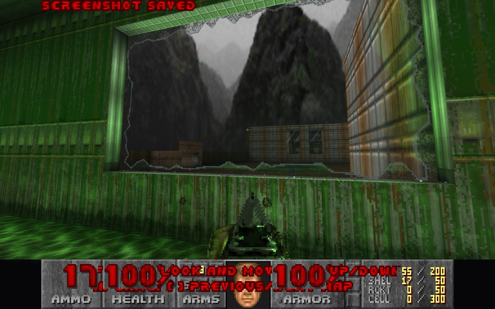
</p>

With **Glass reflections**, the window filling most of the view reflects the
room with the same mirror trick as water: walls, lamps, monsters, shots and
your own sprite. Sprites are turned around for the mirrored view, so a monster
coming up behind you shows its face in the glass. Every other window shows a
small cube map taken after the level's light has baked, projected onto a box
around the room so nearby walls stay put as you move. Bright things in a
reflection show and dim walls stay faint, so the window stays see-through.

<p>
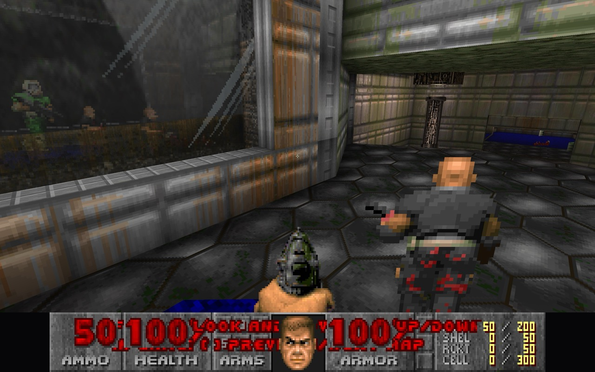
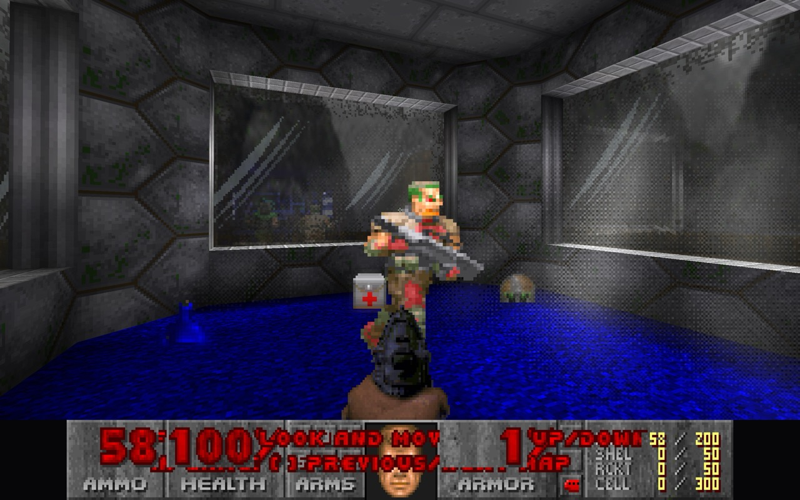
</p>

See [`platform/scene3d/windows.cpp`](platform/scene3d/windows.cpp) and
[`platform/shaders/glass.frag`](platform/shaders/glass.frag).

### Lights can be shot out

Every lamp, light strip and screen that lights the room can be shot out. The
renderer already knows which pixels glow and which light each of them feeds,
so a shot on the glowing part breaks the fixture. A lamp strip spread over a
few small sectors breaks as one; a long lit ceiling or a row of computer boxes
breaks a piece at a time. Lamps forgive a near miss, screens need a hit on the
glass.

A broken tube sputters with a pop and goes grey. A screen dies in a burst of
static and loses its glass to cracks over a black tube. The fixture is taken
out of the baked lighting and its surroundings are baked again around it (see
[Light changes during play](#light-changes-during-play)). A room lit only by
its lamps ends up close to pitch black.

Bullets, fireballs and plasma break what they hit. Rockets and barrels break
every lamp and screen their blast can see. Monsters' shots count too, and with
**Kill shots carry on** a bullet that kills its target carries on to the wall
behind it, so a fight wears the light down. Tech walls crackle and throw blue
sparks when hit. Like the glass, all of this is in the renderer only: monsters
see as they always did, and loading a save brings the lights back.

There is no screenshot of this on purpose. It's better found in a fight.

See [`platform/scene3d/shot_lights.cpp`](platform/scene3d/shot_lights.cpp).

### Blinking and pulsing lights

DOOM flickers a light by changing a sector's light level, and the lamp in that
sector flickered along because every pixel was drawn at the sector's
brightness. Once lamps became light sources here, their glowing pixels were
drawn at full brightness and their light was baked, so every lamp shone
steadily. A lot of DOOM's mood turned out to live in those blinking lights.

Each flickering sector's light thinker says how far its level swings, and the
lamps in it follow. Blinking and strobing sectors switch their lamps off in
the lower half of the swing; glowing and fire-flickering sectors fade them.
Screens beside them stay on unless they are the sector's only glowing
textures. A switched-off tube is drawn grey and dead, like a shot-out one.

The light stays baked. Each flickering sector's lamps get one of 15 flicker
groups. Every wall texel and floor cell records which group lights it most
and how much, and the shader scales that share every frame. Each cell is
switched by its own group before the four nearest cells are blended, so no
patch of lamp light stays lit while the lamp is out. Torches, candles and
other animated decorations get flicker groups too.

Shoot out every lamp of a flickering room and it stops flickering.

See [`platform/scene3d/surface_lights.cpp`](platform/scene3d/surface_lights.cpp),
[`platform/scene3d/bake_lights.cpp`](platform/scene3d/bake_lights.cpp) and
[`platform/shaders/world/bake.glsl`](platform/shaders/world/bake.glsl).

### Water reflects the room

When water is visible near the player, the nearest water level becomes a
mirror plane and the world is drawn again from a camera flipped across it.
The water shader distorts the image with simple waves and with the brightness
changes in the animated flat, so DOOM's own texels break up the reflection.
Nukage, slime, blood and lava don't reflect.

The default **Retro reflections** draw the mirror at one-eighth resolution with
hard pixels and palette colours, in PS1 style. Off, it draws at half
resolution.

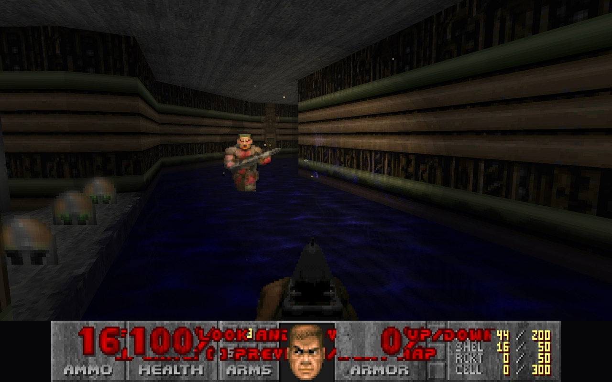

See
[`platform/gpu3d/frame.cpp`](platform/gpu3d/frame.cpp) and
[`platform/shaders/world.frag`](platform/shaders/world.frag).

### Liquids affect what's around them

Liquids throw moving caustics onto nearby walls, ceilings and the monsters and
things near them. By default the pattern is the light the flat's waves would
gather, worked out at level load: soft near the water, sharp lines about 40
units up, broader above, swaying more the higher up the wall. The flashlight's
caustics depend on how flat the beam strikes the water. Each of these has its
own switch under **F4 → Graphics → Liquids → Caustics**.

Banks just above water, nukage, slime and blood turn damp up to a ragged line.
Walls running straight into nukage, slime or lava take the glowing strip the
game paints at the foot of its own edge textures, such as DOOM's `NUKE24`
steps, so every wall meeting the liquid gets it. Along the shore, thin ripple
lines run out from the walls: quick and fine on water, slow and broad on
nukage and slime, glowing on lava, a still dark line on blood. **Shore
ripples** can be drawn as blocks of DOOM pixels or lit in the liquid's own
texels, which costs nothing.

Big pools read as one body of liquid. Far away and at grazing angles the
flat's detail fades toward the animation's average colour, and the surface
drifts between calmer and rougher patches. Up close the WAD's own flat is the
detail.

Bullets hitting liquid throw palette-coloured drops and rings, and things
landing or wading in it disturb it. Nukage, slime, blood and lava act heavier,
with slower rings, bigger drops, bubbles and a wobbling collar around anything
standing in them.

Below freezing, water ices over map cell by map cell and gathers into floes.
Splashes and caustics stay under the ice.

<p>
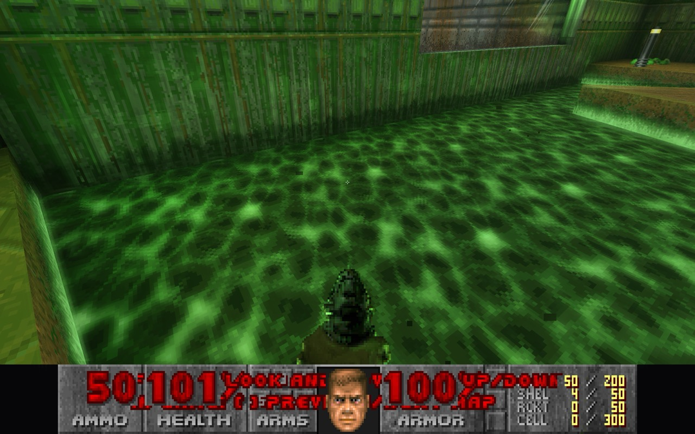
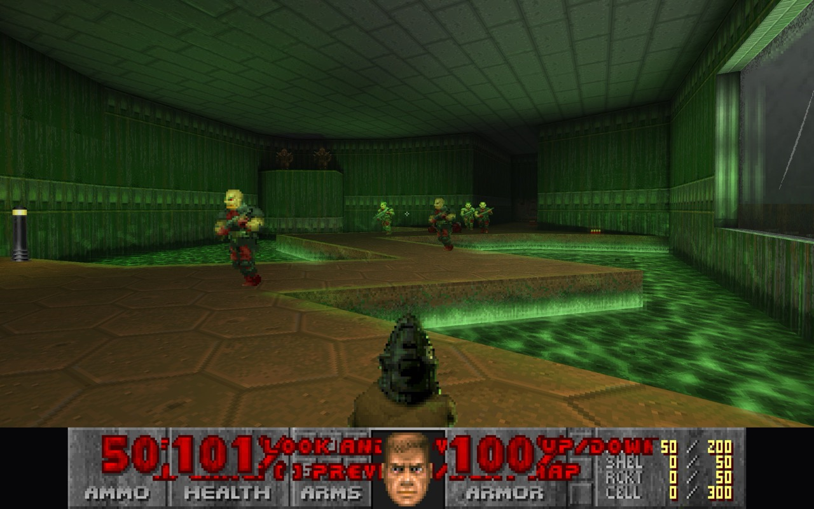
</p>

See [`platform/scene3d/liquids.cpp`](platform/scene3d/liquids.cpp),
[`platform/scene3d/caustics.cpp`](platform/scene3d/caustics.cpp) and
[`platform/scene3d/water_ice.cpp`](platform/scene3d/water_ice.cpp).

### Skies have depth

With **Sky depth**, mountains painted into the sky stand at their own
distances. Walking and climbing shift the near ridges against the far ones,
and valley mist drifts between them. DOOM's rocky skies become karst towers,
DOOM II's city skyline becomes buildings, and its burning city gets a
firestorm with fires under the smoke. Hell's skies get flames fanned by the
wind.

Skies of clouds alone keep their painting and get volumetric clouds built over
it, using the painting as a map of where cloud lies and in what tone. The
clouds follow the weather, its amount, the hour and the wind, cast soft
shadows over the mountains, and let god rays through. A low sun throws long
lanes of light across the cloud deck.

In light rain with the sun out you get a sunshower: the cloud breaks, the
drops catch the light and a rainbow stands opposite the sun.

**Sky** can be *Real time* or *Cached*. Cached paints the costly part of the
sky into a small panorama a little at a time and looks it up, which is much
cheaper; clouds then step along a few times a second. *Cached, chunky* paints
it at about DOOM's own pixel size. **Sun in the sky** draws a faint sun disc
where the baked sunlight comes from.

See [`platform/scene3d/sky_layers.cpp`](platform/scene3d/sky_layers.cpp),
[`platform/scene3d/sky_city.cpp`](platform/scene3d/sky_city.cpp),
[`platform/scene3d/sky_clouds_bake.cpp`](platform/scene3d/sky_clouds_bake.cpp)
and [`platform/gpu3d/sky_cache.cpp`](platform/gpu3d/sky_cache.cpp).

### Fog, mist and sunbeams are simple fakes

Distance fog is an exponential formula with no raymarching. Pits, liquids and
damaging floors carry low layers of mist. Sunlit openings cast simple light
shafts back toward the sun, with dust motes showing only where the sun or
flashlight catches them. Hot floors and flames make a sideways shimmer that
steps with the game tics (**Heat haze**, off by default). Flames shed a few
one-pixel embers that rise, cool to dark red and go out, and Heretic's wind
sectors carry them off.

The sun's position is inferred from the level's sky lighting unless the map or
the time of day sets it.

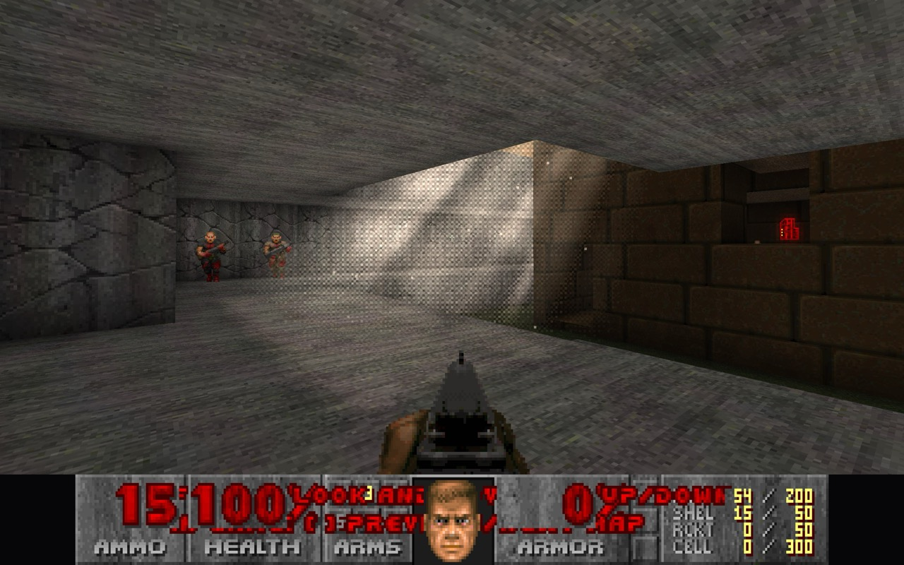

See
[`platform/volumetric_fog.h`](platform/volumetric_fog.h),
[`platform/scene3d/atmosphere.cpp`](platform/scene3d/atmosphere.cpp),
[`platform/shaders/mist.frag`](platform/shaders/mist.frag) and
[`platform/shaders/present.frag`](platform/shaders/present.frag).

### Sun and sky light follow one rule

Every surface takes sun and sky light by how much of the sky it really sees,
traced when the level loads. There are no separate indoor and outdoor rules,
so nothing steps where a roof ends. Porches, doorless recesses and the space
under an overhang count as one open ground with the yard they open onto.

See [`platform/scene3d/bake_sun.cpp`](platform/scene3d/bake_sun.cpp) and
[`platform/scene3d/open_air.cpp`](platform/scene3d/open_air.cpp).

### The climate is picked, the weather worked out

**F4 → Game → World → Weather** has these choices, each either the map's own
or one value for every map:

| Choice | Values |
| --- | --- |
| Weather | Clear, Rain, Snow, Nukage rain, Sand, Ash, Fog, Dry ice, Firestorm, or Random |
| Amount | Light, Moderate, Heavy, Extreme |
| Time of day | Dawn, Morning, Noon, Afternoon, Dusk, Night |
| Temperature | −30 °C to 50 °C |
| Wind and Wind from | Still, Breeze, Strong, Gale; eight compass directions |

**Random** rolls a climate for every map. The menu only offers combinations
that fit (no snow above freezing, no sandstorm in still air, no fog in a gale,
no 50 °C at night) and works down its order: a choice that clashes with one
above it moves to the nearest value that fits. Where the map's own weather
clashes with a choice, the map gives way.

What each weather does:

- **Rain** falls as streaks of whole DOOM pixels at the game's tic rate,
  splashes where it lands and rings on liquids.
- **Snow** falls as flakes one DOOM pixel wide and lies in ragged drifts. Hard
  snow in a hard wind turns into a blizzard with a whiteout whose density is
  shaped on real visibility data. Out in the snow, echoes fade and dull.
- **Sand** blows along the ground with a dust haze and creeps in ripples.
- **Ash** falls dark grey with a few glowing embers.
- **Fog** lies smooth in the low ground. **Dry ice** lies banded and heavy,
  pours off ledges and fills pits while walkways stay clear.
- **Nukage rain** hurts what stands under it, so like Phobos it is off in demos
  and netgames.
- **Firestorm** is the air over a burning city: sparks carried off the fires
  on the wind, black soot drifting down, smoke lit orange from below.

Heat from 30 °C bleaches the sky, raises a warm haze and makes the far ground
shimmer. Below 0 °C windows frost from their edges in. Dawn and dusk give a
low orange sun with soft shadows, noon the hardest shadows, night no sun at
all, with lit rooms shining out through their windows. Changing the hour
re-bakes the light. **Lamps light the weather** makes snow, sand and ash take
a lamp's colour in a soft ball around it and rain glint close by.

The outdoors stays a shader trick: the sky's far weather is drawn as sheets
and nothing is simulated where no one would notice. Clear weather costs
nothing.

See [`platform/climate_rules.h`](platform/climate_rules.h),
[`platform/scene3d/climate.cpp`](platform/scene3d/climate.cpp),
[`platform/scene3d/snow.cpp`](platform/scene3d/snow.cpp),
[`platform/scene3d/sand.cpp`](platform/scene3d/sand.cpp),
[`platform/scene3d/ash.cpp`](platform/scene3d/ash.cpp),
[`platform/scene3d/fog.cpp`](platform/scene3d/fog.cpp),
[`platform/scene3d/dry_ice.cpp`](platform/scene3d/dry_ice.cpp),
[`platform/scene3d/whiteout.cpp`](platform/scene3d/whiteout.cpp) and
[`platform/scene3d/weather_lamps.cpp`](platform/scene3d/weather_lamps.cpp).

### Rain, night and wear

In DERP mode the game's own maps get a look picked by hand. DOOM's first
episode lies at night in a steady downpour: the sun is hidden and the lit
rooms shine out into the dark. Only maps the IWAD itself holds get this;
Freedoom and PWADs keep the derived look. The picks are kept in
[`platform/games/doom/authored/`](platform/games/doom/authored/), in
DERPINFO's words.

Drops gather and run down the outside of the window glass, and the ground
under the sky lies wet in a few baked steps. Through a broken window the wind
blows the rain in and the floor and wall beneath it soak. A few rooms beside
the open sky have a crack in the ceiling with rain dripping onto a small
puddle. The rain is heard as a dense, soft patter.

See [`platform/scene3d/weather.cpp`](platform/scene3d/weather.cpp) and
[`platform/games/doom/authored.c`](platform/games/doom/authored.c).

### Rooms are found in the map, and the wind blows through them

When a level loads, its sectors are joined into rooms. Sectors that open wide
into each other (a pedestal, a step, a strip of other light) are one room.
Doors, window frames and narrow recesses are openings. A sector open to the
sky along much of its edge is a porch and counts as outside.

Air flows between rooms through their openings, pushed by the wind outside,
and every room keeps a temperature. What falls outside rides those drafts
indoors: snow trails across the floor from a broken window, slush where it's
warmer, rime round cold inlets, sand piling up inside a doorway. A door opened
during play lays snow and rain in front of it as a broken window does.

See [`platform/rooms.c`](platform/rooms.c),
[`platform/scene3d/drafts.cpp`](platform/scene3d/drafts.cpp),
[`platform/scene3d/floor_film.cpp`](platform/scene3d/floor_film.cpp) and
[`platform/scene3d/blown_in.cpp`](platform/scene3d/blown_in.cpp).

### The weather is pushed around

Gusts roll across open ground and shove every flake, drop and grain. Indoors
a draft stirs what rides it, tight at the opening and swirling where it turns.

A rocket, barrel or BFG ball shoves what flies, blows the drifts on the floor
into a ragged rim, punches a hole in the fog that fills back in from its edge,
and throws up a puff of whatever lay there. Projectiles leave wakes, bodies
land in puffs, footsteps leave prints, bullets kick the floor and slamming
doors breathe out. Torches and anything burning are hot spots: snow melts and
fog boils away above them. Outdoors, craters and prints fill back in as more
falls or the wind blows.

A hit takes a few frames, recovery takes seconds, and anything settled sleeps,
so a quiet room costs nothing.

See [`platform/scene3d/air_push.cpp`](platform/scene3d/air_push.cpp),
[`platform/scene3d/disturbances.cpp`](platform/scene3d/disturbances.cpp) and
[`platform/scene3d/ground_dents.cpp`](platform/scene3d/ground_dents.cpp).

### Blood

**F4 → Graphics → Combat → Blood** has three levels.

**Splats** leaves blood on floors and nearby walls after hitscan hits, and
corpses grow pools. The colours are sampled from the WAD's blood sprites.
Pools grow in visible steps, find steps and ledges and run down them.

**Full**, the default, adds spray. Hits throw blood out the far side of the
body and kills burst. Each drop's flight is worked out once, when it is
thrown: it flies as a DOOM-sized speck and lands as a splat on the floor, a
wall in its way or a low ceiling. Fresh wounds drip, bodies sliding across the
floor smear it, bodies thrown into a wall splash it, and fresh blood glints
under lights before drying matte. Blood falling into water, nukage, lava, snow
or sand behaves like it.

**Enemy-appropriate blood** gives each monster its own colour: cacodemons
blue, Barons and Hell Knights green, the rest red. Lost Souls don't bleed.

All of it uses its own random numbers, so the game never notices.

See [`platform/scene3d/blood.cpp`](platform/scene3d/blood.cpp) and
[`platform/scene3d/spray.cpp`](platform/scene3d/spray.cpp).

### Shots go through monsters

With **Wound holes**, a bullet or pellet shoots through the monster's sprite.
The hole is cut from the texels the shot crossed, with a ragged edge in the
blood sprite's reds, a dark torn rim and a short smear, in the WAD's own
palette. The game's hit test and damage are untouched.

DOOM's sprites have no skeleton and no shared texture coordinates, so a hole
has to find its place again on every frame. It remembers the texel it struck
on the drawing showing at the moment of the hit. Every later frame looks for
that patch of artwork, first by its place among the drawing's rows and then by
a small search for the nearest match in colour and coverage. Matching always
goes back to the original hit, so the hole doesn't drift. A hole shot from the
front closes when the monster turns side-on. Close hits open it wider, hits
next to each other merge, and the holes stay on the corpse.

Where a bullet lands depends on the aim. With free look, bullets go where you
look, so a shot at the head hits the head and a shot over a shoulder misses.
**Classic aim** (**F4 → Controls → Aim**) brings back DOOM's autoaim for
bullets, which strike the middle of the monster's height. Rockets, plasma and
BFG balls follow the same rule: along the view with free aim, autoaimed with
Classic aim. Demos and netgames always aim as in vanilla.

See [`platform/scene3d/wounds.cpp`](platform/scene3d/wounds.cpp) and
[`platform/wound_attachment.h`](platform/wound_attachment.h).

### Gore

**F4 → Game → World → Gore** is on by default. It changes the game's rules,
so it may break saves and demos, and it is off in demos and netgames.

Killing blows tear bodies apart. A blast in the face or a super shotgun at
point blank takes the head off and the neck pumps on for a few seconds. Close
blasts tear off limbs, big monsters can be cut in two, a pistol headshot tears
the skull, and a rocket into a cacodemon's open mouth blows it up like a
balloon. Wounds go through to the bone, read from a bone map under each
monster's skin. Stumps get a ragged cut, a skin lip and bone; flying pieces
carry the matching bone on their torn end. With **Tear fibres**, a torn-off
part stays joined to the body for a moment by fibres that stretch and snap one
by one. That is made for slow motion and is a flicker at full speed.

Bodies torn apart always fall as ragdolls.

See [`platform/scene3d/gore.cpp`](platform/scene3d/gore.cpp),
[`platform/scene3d/stump_rim.cpp`](platform/scene3d/stump_rim.cpp) and
[`platform/scene3d/tear_fibres.cpp`](platform/scene3d/tear_fibres.cpp).

### Monsters die differently every time

DOOM draws each monster's death once and plays it the same way every time.
Here the drawing takes over at the killing blow and works out a death from how
the hit landed. The game's states, timing and corpse are untouched, and the
variation comes from hashes instead of DOOM's random table, so demos stay in
sync.

**F4 → Graphics → Combat → Deaths** picks how far it goes:

- **Classic:** the game's own death frames.
- **Varied:** the frames keep their order, but the time is shared out afresh
  for each kill: one body snaps down, another hesitates and drops, another
  slumps. Monsters killed by one rocket get contrasting timings so a group
  doesn't fall in step. A hit off the middle can turn a monster on its own
  rotated frames, and a hard push steps it back. The frames are mirrored so
  the body falls away from the blow.
- **Procedural falls:** monsters on two legs fall in ways their drawings never
  show. Each gets a rig of hips, knees and ankles; the zombieman, shotgun guy
  and chaingunner are rigged by hand, and other artwork has its joints found
  by following the legs up from the floor. Every texel is drawn as its own
  small quad moved by the rig, so the pixels stay sharp. A low or weak hit
  sweeps the legs, a hard hit is a chest blast that can throw the body off its
  feet, and a killing headshot cuts the strings so it crumples where it stood.
- **Ragdolls:** the monster falls as a body in 3D and a camera of its own
  draws it back into a DOOM sprite (below).
- **Ragdolls, Hollywood**, the default: shots punch harder and spin the body,
  explosions send bodies flying off walls and columns, gibs included. Big
  blasts cost more CPU, and the Arch-vile raises the game's corpse where the
  monster died, which may be away from where its body landed.

**Hit reactions** makes monsters lean with the push of every hit and spring
back, and jolts dying ones with the killing blow. **Reaction strength** sets
how far.

Hand rigs hold only for the original artwork. Each is keyed to a hash of the
sprite's pixels, so replaced art falls back to the joint finder, and a monster
without two clear legs keeps its drawn death.

The rigs and falls were worked out in a small lab outside the game: Python
scripts in [`tests/`](tests/) that read a WAD and draw poses side by side
(`death_lab.py`, `death_pose.py`, `death_sim.py`, and `joint_finder.py`, which
scores the joints it finds against the hand rigs). Research on deforming
hand-drawn characters from their animation frames,
[Neural Puppet: Generative Layered Cartoon Characters](https://arxiv.org/abs/1910.02060),
informed these experiments. Nothing is learned: rigs are placed by hand or
found by a fixed rule.

See [`platform/scene3d/body_motion.cpp`](platform/scene3d/body_motion.cpp),
[`platform/scene3d/death_director.cpp`](platform/scene3d/death_director.cpp),
[`platform/scene3d/death_falls.cpp`](platform/scene3d/death_falls.cpp) and
[`platform/death_rigs_stock.h`](platform/death_rigs_stock.h).

### Ragdolls are drawn back into sprites

- **A body from the drawing.** The rigged pain drawing is raised into a
  relief. Each texel rises as deep as the tube the sprite lighting finds under
  it, and the side drawing sets how far the body reaches forward and back, so
  a body lying down is as deep as its own side view. The front is painted from
  the front drawing and the back from the drawing seen from behind.
- **A small skeleton.** Eleven points on the drawing's rig (head, neck,
  shoulders, spine, hips, knees, ankles) are integrated in game tics and held
  together by bone lengths and joint limits. Muscles hold the standing pose at
  first and let go on a schedule set by the hit. Floors, steps, ledges and
  walls stop the body, so it can fall down a step, slam into a wall and sink
  to sitting, go over a low wall or skid on ice. Soldiers killed kneeling fall
  from the kneel.
- **The hit decides the fall.** A body can be thrown back, have its legs
  swept, be spun from the side or have its strings cut by a headshot. While
  it falls it is turned so it lands with a drawn side facing up or toward the
  player. Some chest blasts on the zombieman play the death its drawings show:
  the chest yanked back as if on a stunt wire, the legs giving way.
- **Back to 2D.** An orthographic camera draws the posed body into a square
  picture in the WAD's texels, quickly through the hit and then at the pace of
  the monster's own death frames. The picture stands on an ordinary sprite
  card and is lit like any sprite. Once the body lies still, its last picture
  becomes a plain corpse sprite.

**Ragdoll pixels** chooses how the body is turned back into DOOM pixels each
time it moves. Nearest is the crispest, and thin parts like a rifle flicker as
the body turns. The Anchored, Coverage and Blended choices trade a little
sharpness for less flicker, and their *steady* versions halve it again.

Everything here is drawing only. Where the corpse lies, its hitbox and the
game's timing stay vanilla.

The lab has more scripts for the ragdoll: `death_hull.py` (a 3D puppet carved
out of the eight walk rotations), `death_relief.py`, `death_ragdoll.py`,
`death_impostor.py`, `ragdoll_settle.py`, and `voxel_reference.py` and
`voxel_relief.py`, which check the depth guess against an artist's voxel
models read from a local folder (never shipped). `ragdoll_arena.py` builds
small test maps from plain geometry, plays scripted kills and saves the falls
as a contact sheet; its `showcase` mode keeps shooting a row of monsters until
you quit.

See [`platform/scene3d/ragdoll.cpp`](platform/scene3d/ragdoll.cpp),
[`platform/scene3d/ragdoll_body.cpp`](platform/scene3d/ragdoll_body.cpp) and
[`platform/scene3d/ragdoll.h`](platform/scene3d/ragdoll.h).

### Slow motion

**F4 → Graphics → Combat → Slow motion** slows the world to a quarter of its
speed while you keep aiming at full speed. Bullets visibly fly and leave
rippling air behind, colours pop, the sound drops and echoes ring longer.

- **Key:** the Slow motion key (X, or F12) turns it on and off.
- **When shooting:** the first shot slows the world, and it stays slow while
  you keep firing and for five seconds after, so deaths play out slowly. The
  right mouse button starts it without a shot and ends it early.

Your gun keeps closer to your own time: switching weapons takes as long as
ever, and firing runs at half speed. In DERP mode slow motion has the price
described under [DERP mode](#derp-mode), and the shootslide works whatever
this is set to. It is off by default and never runs in multiplayer.

See [`platform/slow_motion.c`](platform/slow_motion.c) and
[`linuxdoom-1.10/p_focus.c`](linuxdoom-1.10/p_focus.c).

### Pixel art stays sharp

The renderer draws at the display's native resolution and can keep the
textures sharp. World textures can use nearest filtering, bilinear, or sharp
bilinear, which keeps each texel flat and softens only its edge. Palette
mipmaps keep distant surfaces from shimmering. Sprites can stay
nearest-neighbour or use soft filtering. An optional final pass quantizes the
whole image to the current WAD palette, including lighting, fog and bloom.

DOOM's pixels were drawn for a 4:3 CRT at 320×200, so they stood 1.2 times
taller than wide. The world is drawn that way too, so a texel covers the same
screen area as a status bar pixel.

Animated walls and flats crossfade between frames. Doors, lifts, sprites and
the camera are interpolated between DOOM's 35 Hz tics.

**Status bar size** shrinks the bar in steps that keep every DOOM pixel a
whole number of screen pixels, and **Status bar width** can spread it across
the screen with the wide bar's sides from the 2019 and later IWADs.
**Resolution** can be a share of the window or a fixed height, down to 240p,
with crisp or sharp-bilinear upscaling. **Window size** sets the window to an
exact standard size for recordings.

### Smaller touches

- Pickups catch a passing glint now and then, the way metal and glass do. With
  **Pickup flash: By item**, the screen tint takes the colour of what you
  picked up: health green, armour blue, keys their own colour.
- The automap marks the lines the 3D view has seen.
- **Retro scanlines** draw dark lines between rows, like an old CRT.

## How the sound works

Sound gets the same treatment as the graphics and is as big a part of the
project. The WAD's own effects still play as crunchy 8-bit samples, and
everything around them is worked out from the map while you play: where sound
can travel, how big and how hard the room is, and what in it should be making
a noise.

The WAD has nothing for sparks, breaking glass, footsteps, a humming lamp or
bubbling nukage, and DERP adds no recordings for them. Each is a small synth
that models how the thing makes its sound: a ballast buzzing at twice the
mains frequency, bubbles rising in pitch as they near the surface, a crack
front branching through a pane, shards falling under DOOM's gravity and
ticking where they land. At startup they are rendered as 8-bit samples like
DOOM's own, mostly at 11 kHz. Glass uses 22 kHz to keep its bright collision
detail above 5.5 kHz. Which of them plays where is read from the map's
textures.

The target is a late-90s A3D or EAX sound card with a fairly short, lo-fi
reverb. The settings are in **F4 → Sound**.

### Quiet by design

The soundscape is quiet on purpose. A lamp's buzz, distant bubbling and wind
through a broken window are meant to be heard under the gunfire, and DOOM's
music, mixed loud and played dry, covers them. To hear them, turn the music
down or off in **Options → Sound Volume → Music Volume**.

### Sound finds its way through the map

When a level loads, every two-sided line becomes an opening between two
sectors. Sound travels from opening to opening, and a search outward from the
player finds, for each opening in reach, how long the way there is and what
was lost on the way. The search runs again whenever the player moves or a few
tics pass, and openings are read live, so a door that opens, a lift that rises
or a window that breaks changes what gets through as it happens.

Distance and loss are kept apart. A closed door, a narrow slit or a pane of
glass makes a sound quieter and duller without making it farther away. Sectors
are only topology here, so a staircase of twenty sectors counts as one way.

In DERP mode sound carries through the whole level.

### Walls muffle, distance dulls

Each positioned sound has its own two-stage lowpass filter, updated every
other tic while the sound or the player moves.

- **In sight:** only distance removes treble, from about 200 units out.
- **In the same room, out of sight:** over a ledge or behind a pillar, it is
  muffled a little.
- **Elsewhere:** it is heard the way the openings let it through. The longer
  the way round compared to the straight line, the duller it gets, and a shut
  door, a slit or glass on the way dulls it further.
- **Sealed off:** with no way through, it is muffled heavily.

Muffling changes only the tone, never the volume, so you can locate monsters
by ear as well as before.

### Sound fades as it does in air

DOOM fades a sound in a straight line from full strength at 160 units to
nothing at 1200, so a monster across a big room sounds almost as near as one
beside you. **Natural distance falloff**, on by default, halves the strength
each time the distance doubles, easing out to nothing at the same 1200 units.
Gunshots and explosions carry two and a half times as far, faint and dull by
then, and breaking windows twice as far. When every channel is busy, the
faintest sound gives way. DOOM's boss maps, which play every sound at full
volume, stay as they are, and Heretic keeps its own curve.

### Rooms are measured with rays

Every other tic, 32 rays go out from the player across the map in a flat
circle. A ray stops at a one-sided wall or at an opening too low for sound,
such as a closed door. Rays that leave through open sky don't come back.

The rays give the distance to the walls and sketch the floor plan. That plan,
the ceiling heights the rays crossed and how much is open sky give a room
volume for Sabine's reverberation formula, squeezed into a game-like range:
corridors slap back, big halls boom and outdoors stays almost dry.

WADs have no material data, so materials are guessed from texture names.
`STARTAN`, `COMP` and `METAL` ring like metal, `WOOD` and the panel textures
sound dull, and flesh, liquids, dirt and carpet absorb sound in their own
ways. A switch counts as the wall it is set into (`SW1STON1` is stone,
`SW1WOOD` wood), and a short list of single textures corrects what the names
get wrong. Anything else counts as stone. Footsteps use the same materials.

Each material also has a roughness. Smooth panels send an echo back clean and
keep a room ringing; rough stone and dirt scatter it. A texture's artwork adds
to that: the share of its texels lying in painted seams, ribs and cracks,
read the first time a ray meets it. Ribbed metal rings less than sheet metal.
The reading only roughens a material and never decides it, because it agrees
only moderately with a hand-judged list of DOOM's surfaces.

### Echoes and a reverb tail

The rays are grouped into eight directions around the player. Each group makes
one echo, delayed by the round trip to its walls and panned by where they are.
A ninth comes off the ceiling. Each echo loses the treble its walls take, and
off rough walls it is smeared into a short cluster.

A small feedback delay network makes the late tail: eight damped delay lines
mixed through a Householder matrix. Metal rooms keep their treble and wooden
ones lose it, and in a rough room allpass filters spread every sound into a
dense wash. When the room changes, the echoes crossfade and the tail glides
over a third of a second, so walking through a door doesn't click.

Far sounds send more to the reverb relative to the dry mix. Your own boots,
splashes and equipment keep their quiet source loudness in the room send.

**Room acoustics** (**F4 → Sound → Hearing → Rooms**) is off by default. It is
the dearest sound option, most of the mixer's work when it is on.

### The hall next door

From a corridor or a small room, some rays run out through an opening into a
bigger space. That space is measured as a room of its own and heard through
the opening with a second reverb: your own sounds ring there faintly, and
sounds made inside it echo as the hall does. Only a space that is clearly
bigger and rings longer counts.

See [`platform/audio/beyond.c`](platform/audio/beyond.c).

### Tunnels ring like sewers

A long narrow passage is recognised from the floor plan: the longest pair of
opposite rays, read straight across the side walls, ignoring doorways and
alcoves. In such a tube the tail grows from its cross-section, up to two and a
half times the room's own, sound flutters between the side walls (more over
water), and echoes from along it are smeared so no copy comes back off the far
end. Rooms that aren't tubes sound as before.

See [`platform/audio/room.c`](platform/audio/room.c) and
[`platform/audio/reverb.c`](platform/audio/reverb.c).

### Room tails traced from the map

In DERP mode three more options under **F4 → Sound → Hearing → Rooms** apply:

- **Room tails: Traced** traces each room's ringing at level start, with
  sound bouncing off its real walls, floors and ceilings and their materials
  and coming back from where they are as you turn. *Classic*, the default,
  plays the one synthetic tail above for every room. The early echoes are the
  same in both. Tails are only traced while room acoustics or far rooms are on.
- **Far rooms ringing** lets a sound made in another room ring as that room
  does, its echo reaching you through the doorways. Three far rooms can ring
  at once, or one, or none (the default).
- **Measuring the room: Baked grid** measures the room acoustics once at level
  start on spare cores, so they stay steady as you walk past far doorways.
  *Live rays* measures them as you move, as on every other map. The grid fills
  in nearest first, with live rays used until it gets there.

On headphones the tails' low end is the same in both ears.

See [`platform/audio/room_tails.c`](platform/audio/room_tails.c),
[`platform/audio/room_trace.c`](platform/audio/room_trace.c),
[`platform/audio/room_grid.c`](platform/audio/room_grid.c) and
[`platform/audio/far_tail.c`](platform/audio/far_tail.c).

### Headphones

**F4 → Sound → Music → Output** can be set to headphones. Sounds in the world
then come from where they are, ahead or behind, above or below, through head
measurements from the SADIE II database (University of York). *KEMAR* tells
front from back best; *KU100* is more neutral. Your own weapons and steps, the
music and the weather stay as they are. It sounds wrong on speakers.

See [`platform/audio/hrtf.c`](platform/audio/hrtf.c).

### The map hums

When a level starts, its textures and things are read for what should make a
sound:

- **Lamps** buzz like a ballast. A steady lamp is barely heard; one in a
  flickering sector buzzes with its light, cuts out when it drops, and ticks
  and crackles as the tube strikes again.
- **Screens** hum under faint static, and **computer walls** chatter in
  little bleeping tunes.
- **Nukage and slime** bubble thick and low, with a big blorp now and then.
  **Blood** bubbles slower and deeper, **slime falls** pour, and DOOM's
  mostly still **water** drips.
- **Lava** rumbles and heaves up heavy bubbles, **fire walls**, torches and
  burning barrels roar and crackle, and cracked **magma** rock ticks over a
  faint rumble. **Teleporter pads** throb.
- **Wind** blows wherever the sky is open and comes indoors through the
  windows and doorways that open onto it. Past a breeze it never lets up, with
  a low roar buffeting under it. In DERP mode three winds play as one live
  voice.

Sources of a kind close together join into one spot, and each spot is heard
through the same openings as any other sound. Window glass holds the wind back
to a dull rush until it is shot. Each kind plays in up to three layers with
different takes of its loop, so a room full of computers sounds fuller rather
than only louder. A faint room tone runs under it all. Only nearby sources are
heard, loud effects push the ambience down for a moment, and a fixture that is
shot out goes quiet for the rest of the level. **Ambience volume** sets how
loud it is. **Ambience** (**F4 → Sound → Made-up sounds**) is off by default.

**Alternative computer sounds** (**F4 → Sound → Made-up sounds**, off by
default) replaces the computer bleeps with a contained machine hum, fine
hard-drive seeks, occasional relay clacks and electrical chatter.

**Inside the walls**, now and then, the base works. The one-sided walls are
read for what might live behind them, and every so often one in reach plays it
from a point along its face: water rushing through a pipe, a blast of steam, a
duct, a press, a drip, metal settling. Only the body of the sound gets
through, muffled as if through the wall. None of it sounds like a person, so
there is no knocking and there are no steps. The sounds are rare, never the
same kind twice running, and go quiet while you fight.

See [`platform/audio/ambience_map.c`](platform/audio/ambience_map.c),
[`platform/audio/ambience.c`](platform/audio/ambience.c),
[`platform/audio/hidden.c`](platform/audio/hidden.c) and
[`platform/audio/hidden_synth.c`](platform/audio/hidden_synth.c).

### Sounds DOOM never had

The rest of the made-up sounds answer what happens in the fight. Each comes
in six variations, footsteps in sixteen, and neither of the last two takes
plays again.

- **Sparks:** tech walls crackle, fizz or zap after the shot that hit them.
- **Dying lights:** a lamp's hum sputters into a pop and a few bits of tube; a
  screen bursts into static and thumps off.
- **Breaking glass:** each shard keeps its own short resonances as it catches
  the frame, falls under DOOM's gravity, rebounds and tips over its edges.
  **Breaking glass** picks how the break starts: *Shatter*, a hard crack and
  the clatter of larger pieces, or *Fracture*, a crack front branching through
  the pane as hundreds of tiny clicks. The
  [synthesis notes](platform/audio/glass_synthesis.md) describe the reference
  measurements and contact model.
- **Footsteps:** the player is heavy and wears combat boots. Each step is a
  dense impact with the body's weight in it, coloured by the floor: grit on
  stone, a short metallic edge under a rubber sole on metal, a knock on wood,
  a crunch on grass and dirt, muffled on carpet. Ambiguous rusty floors count
  as stone. Running lands harder and pushes off with a scrape, and a landing
  is harder the faster the fall. After each step the kit settles: buckles and
  pouches with a light weapon, a long gun knocking on its sling, the rocket
  launcher or BFG thudding, the click of armour when you wear it. With
  **Weapon bob: Sync to footsteps** (**F4 → Controls → Aim**) the weapon swings
  like a pendulum in time with them. Water splashes, nukage, slime, blood and
  lava gloop, and monsters wading through liquids splash. Monsters on dry
  floors stay silent, as in vanilla.
- **Gore:** a kill's wet burst and a body slapping into the floor or a wall,
  filtered noise only, played quietly under the monster's own death sound.
  Torn-off parts stretch and snap audibly.
- **Near misses:** an enemy's bullet from far off that passes close by
  whizzes past your head. Real bullets wouldn't sound like that, but it tells
  you you're under fire when the shooter is too far away to hear.

`doom-sfx-render` writes all of them to WAV files, dry and in rooms:

```sh
build/play/doom-sfx-render freedoom1.wad -kind ambient -room room
```

### Samples get treble they never had

DOOM's effects are mostly 11 kHz samples, so they hold nothing above about
5.5 kHz. Played back at 44.1 kHz with each sample held, as vanilla does, the
gap fills with mirror images of the sound. That sizzle is most of the crack in
the pistol, and it rings metallic because it turns the spectrum upside down.
**Sample playback** offers three ways to read between the samples:

- **Original**, the default, holds each sample: raw, gritty and sizzling.
- **Smooth** draws a cubic curve through the samples and keeps a little of the
  sizzle.
- **Clean** uses a windowed-sinc filter and removes the sizzle entirely.

Smooth and Clean alone sound muffled, so they make up treble as the sound
plays. The top octave the sample has is rectified, which doubles its
frequencies, and a second pass adds air above 11 kHz. Only what lands above
the sample's own band is mixed in. **Made-up treble** sets how much; at 100%
it is about as bright as Original without the metallic ring.

**Random pitch** (off by default) starts effects up to three semitones higher
or lower each time, as in the earliest versions of DOOM.

The mixer uses DOOM's 0–15 effects volume scale and DMX-style panning. A peak
limiter briefly ducks the mix when many shots fire at once.

### Music

DOOM's scores are MUS and MIDI files, and how they sound depends on the synth
that plays them. Bobby Prince wrote them on a Roland Sound Canvas. **F4 →
Sound → Music → Music** picks the synth:

- **SoundFont**, the default: the bundled GeneralUser GS bank through
  TinySoundFont, close to the Sound Canvas. A `.sf2` bank in the `soundfonts`
  folder beside `doom.cfg` replaces it.
- **OPL (FM):** an emulated YMF262 chip playing the WAD's own GENMIDI
  instruments, the way DOS DOOM sounded on Sound Blaster cards. The voice
  handling was written from the chip's manual and the published lump formats;
  [`opl_music_spec.md`](platform/audio/opl_music_spec.md) documents it.
- **Mac synthesizer** (Mac only): Apple's built-in General MIDI synth.

**Soundtrack** can swap the scores for recordings from packs you own, placed
beside your game WAD or in the `wads` folder:

| Soundtrack | Pack |
| --- | --- |
| PlayStation (the default when the pack is there) | `HQPSXMUS.WAD` |
| 3DO | `UltimateDoom_3DO.wad`, `Doom2_3DO.wad`, `TNT_3DO.wad`, `Plutonia_3DO.wad` |
| IDKFA remix (Andrew Hulshult) | `extras.wad` from the 2024 re-release |
| Original, recorded | `extras.wad` from the 2024 re-release |

A song the pack doesn't have plays the PC score.

`doom-music-render` renders a WAD's songs to WAV files without starting the
game, so synths and banks can be compared by ear:

```sh
build/play/doom-music-render freedoom1.wad -synth sf2 -song D_E1M1
```

See
[`platform/audio/acoustic_graph.c`](platform/audio/acoustic_graph.c),
[`platform/audio/occlusion.c`](platform/audio/occlusion.c),
[`platform/audio/relief.c`](platform/audio/relief.c),
[`platform/audio/made_bank.c`](platform/audio/made_bank.c),
[`platform/audio/steps.c`](platform/audio/steps.c),
[`platform/audio/flyby.c`](platform/audio/flyby.c),
the synths in [`platform/audio/`](platform/audio/) (`*_synth.c`),
[`platform/audio/resample.c`](platform/audio/resample.c),
[`platform/audio/treble.c`](platform/audio/treble.c),
[`platform/i_music.c`](platform/i_music.c),
[`platform/music_pack.c`](platform/music_pack.c) and
[`platform/kex_tracks.c`](platform/kex_tracks.c).

## Controls

Keyboard and mouse work as in DOOM, with WASD and mouse look. Every action can
take two keys or mouse buttons and a gamepad button under **F4 → Controls →
Bindings**; a mouse wheel notch can be bound to a weapon slot.

Gamepads (Xbox, PlayStation, Switch Pro, 8BitDo, the Steam Deck and most
others) work without setup. **F4 → Controls** sets turn and look speed, the
dead zone, a turn boost when the stick is held all the way over, and swapped
sticks. **Gyro aim** turns the view with the pad on pads that have a gyro,
always or only while a button is held (R4 on the Deck). **Rumble** kicks with
every shot, swells with the BFG as it charges, buzzes with the chainsaw, and
lets you feel hits, falls, explosions and big monsters' steps as loud as you
hear them. Xbox pads also crack under the right trigger.

On a Steam Deck the game starts fullscreen. [PLAY.md](PLAY.md) has the
default bindings and Steam setup.

## For mappers

A `DERPINFO` lump sets, per map, the weather and its amount, the wind, the
hour, the temperature, where the sun stands (per hour if you like), a Turok
style distance fog, wall mirrors, and Phobos physics with a gravity of its
own. Other ports ignore it. You don't have to work out the sun's numbers:
stand on the map, look where the sun should be and press **U**. The line goes
into `derpinfo.txt` in DERP's save folder, ready to copy into your lump. See
[DERPINFO.md](DERPINFO.md).

Custom glow masks can be placed in `Emissive/walls/NAME.png` or
`Emissive/flats/NAME.png` beside `graphics.cfg`; see [PLAY.md](PLAY.md).

## For testers and developers

- **Show FPS: Full** (see [The settings panel](#the-settings-panel)) for bug
  report screenshots.
- `-frametrace` saves where each frame's time went.
- `doom-sfx-render` and `doom-music-render` render sounds and music to WAV.
- A headless demo runner, regression tests and a GPU performance smoke test
  are described in [BUILDING.md](BUILDING.md).

## Game data

This repository contains **no commercial game data**. To build and play from
source you need an IWAD:

- **Freedoom** (free): `freedoom1.wad` or `freedoom2.wad` from
  [freedoom.github.io](https://freedoom.github.io/).
- **DOOM / DOOM II** (commercial): the `.wad` files from a copy you own, for
  example from Steam or GOG.

Please don't commit or upload commercial WAD files to this repository.

## Build

You need CMake 3.21+, a C11/C++17 compiler (Apple Clang, Clang, GCC or Visual
Studio 2022) and, for the 3D renderer, `glslangValidator` (plus `spirv-cross`
on macOS); the Vulkan SDK has both. SDL3 is downloaded if it isn't installed.
The build makes the launcher (`DERP`), `doom` (`Play DERP.app` on the Mac) and
`derp-heretic`; on the Mac the Heretic program goes inside the app.

```sh
cmake -S . -B build/play -DCMAKE_BUILD_TYPE=Release -DDOOM_BUILD_SDL=ON \
  -DDOOM_GAME_DATA="/absolute/path/to/freedoom1.wad"
cmake --build build/play --parallel
ctest --test-dir build/play --output-on-failure
```

[BUILDING.md](BUILDING.md) has the details.

## Credits

[`THIRD_PARTY.md`](THIRD_PARTY.md) lists every library and data set that comes
from elsewhere, with its license. Beyond the code:

- **Microsoft Sam** speaks exactly one word in the game, rendered with
  [OpenSAPI4](https://github.com/phyce/OpenSAPI4).
- **DERP mode's voices and cries** were generated with
  [ElevenLabs](https://elevenlabs.io) and edited for the game. They are not
  under the GPL: `derp-cries.wad` and `derp-voices.wad` have their own licence,
  [`barks/VOICES-LICENSE.txt`](barks/VOICES-LICENSE.txt), which allows using
  them with DERP and passing them on unmodified, and forbids pulling their
  sounds out to use on their own.
- **The kick's leg and the kneeling soldiers** in DERP mode are AI-generated
  stand-in art, made with ChatGPT (OpenAI) and converted to DOOM's palette. The
  kneeling soldiers are drawn after id Software's zombieman and shotgun guy.
- **Headphone output** uses head measurements from the
  [SADIE II database](https://www.york.ac.uk/sadie-project/database.html),
  University of York.
- **SCP_7179_B** draws on "SCP-7179" by Calibold, from the SCP Wiki,
  <https://scpwiki.com/scp-7179>, licensed under
  [CC BY-SA 3.0](https://creativecommons.org/licenses/by-sa/3.0/). The SCP
  Foundation and its concepts belong to the SCP Wiki community. More, with
  spoilers kept behind a fold, in
  [`scp_7179_b/README.md`](scp_7179_b/README.md#credits).

## No warranty

DERP is provided as is, without warranty of any kind. Use it at your own risk.
Sections 15 and 16 of the GPL ([`LICENSE.TXT`](LICENSE.TXT)) say this in full.

## License

Copyright © 2026 robongrui. Licensed under the GNU General Public License
version 3 ([`LICENSE.TXT`](LICENSE.TXT)), with one additional term under
section 7(b): redistributions and derivative works containing the original
DERP contributions must preserve the attribution
"DERP, the DOOM Engine Remaster Project — https://github.com/robongrui/derp".
The full notice is in [`NOTICE.txt`](NOTICE.txt).

The DOOM source by id Software, which this is built on, is GPL version 2 or
later. [`THIRD_PARTY.md`](THIRD_PARTY.md) lists it and the libraries and data
that come from elsewhere, with their licenses.
