# Duct-Tape DOOM

A for-fun experimental port of id Software's 1997 DOOM source release to
macOS, Linux and Windows. It keeps the original game simulation and adds an
optional GPU renderer that builds a 3D scene from the loaded WAD while the game
runs.

Everything the renderer adds is worked out from the original artwork, maps and
game state. It needs no replacement textures, models, authored lighting or
edited maps. The aim is for DOOM to feel more physically coherent while staying
the same game.

## Why this exists

This started as a visual experiment to see how far DOOM's presentation could
be pushed while it still looks and plays like DOOM. I think of it as an art
project. Effects stay or go based on how they look in-game, and the code is
written for trying ideas out quickly. It is not meant to be a reference engine
or a library to build on, and the "duct tape" in the name is accurate.

Most of the effects are fake-modern: cheap tricks of the kind I liked in older
games. They work from the WAD data alone, so ordinary vanilla and
limit-removing WADs get them without their authors preparing anything. I'd be
glad if some of these ideas end up in other projects.

Claude writes much of the code. I decide what the renderer should do and how
it should look, test the results in-game and keep iterating until they match
what I had in mind. Without that workflow I wouldn't have the spare time for a
project like this.

The defaults are how I like to play. Almost everything can be changed in the
graphics panel with **F4**.

## At a glance

- **Accelerated 3D renderer:** SDL_gpu, using Metal on macOS and Vulkan on
  Linux and Windows.
- **Native resolution and any aspect ratio,** with mouse look, interpolated
  movement and optional MSAA.
- **Classic renderer:** the original 320×200 software view is one keypress
  away.
- **No asset pack:** the WAD's own textures, flats, sprites and palettes are
  the source material.
- **Compatibility:** vanilla and limit-removing maps, including DEHACKED
  patches.
- **Not supported:** Boom, MBF21 and GZDoom maps, slopes, 3D floors, model
  packs, ray tracing and multiplayer.
- **Window glass:** windows found in the map get glass that reflects the room
  and shatters when something goes through it.
- **Room acoustics:** echoes and reverb measured from the map, with sounds
  muffled behind walls and dulled by distance.
- **Settings panel:** **F4** switches the individual graphics and sound effects
  on and off and tunes them.
- A headless demo runner, regression tests and a GPU performance smoke test
  for development.

The Mac build gets the most testing. The Linux and Windows builds compile in CI
but have had less real play.

## Download and play

Ready-to-play builds for macOS, Windows and Linux are on the
[Releases page](https://github.com/robongrui/duct-tape-doom/releases). Each one
includes Freedoom, so it plays straight away.

On Windows and Linux, put your own `.wad` files in the `wads` folder next to
the game. On the Mac, choose your WAD folder when the app starts.

[PLAY.md](PLAY.md) has the controls and a description of the graphics options.

## Screenshots

<p>
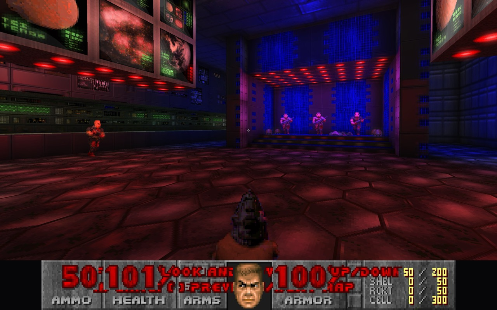
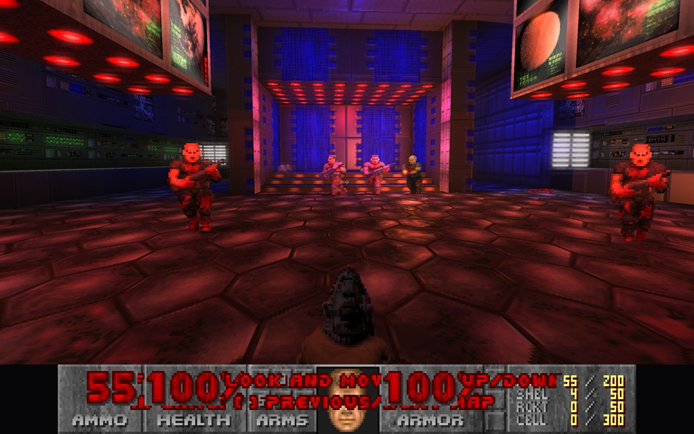
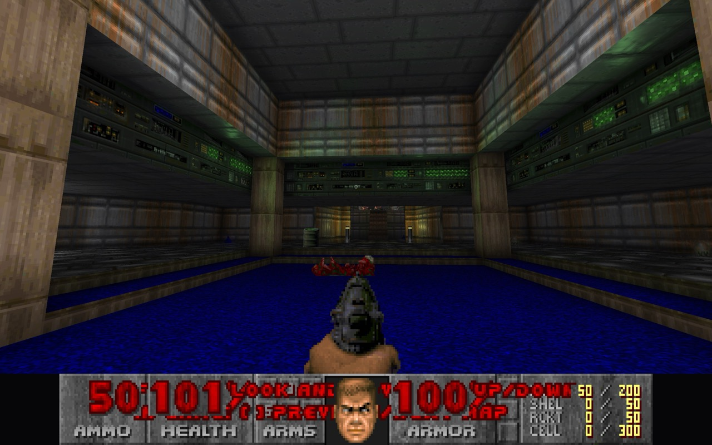
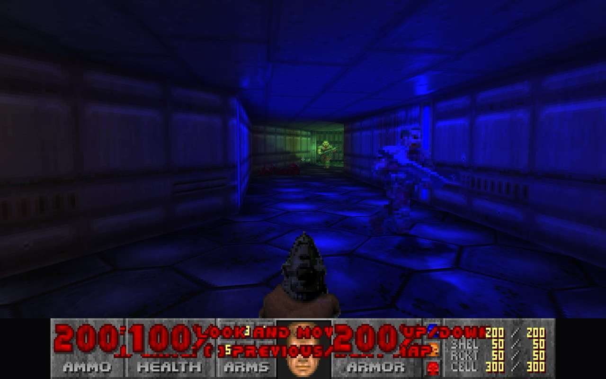
</p>

## How the graphics cheat

### Light comes from things that look like lights

DOOM hints at its lighting through sector brightness, glowing textures and
flats, decorations, windows and the shapes of rooms. The renderer tries to turn
those hints into actual light sources.

Lamp strips, computer panels, lava and other glowing artwork are recognised by
texture name and palette color. Their bright pixels become glow masks and
approximate light sources. Wall panels shine mostly forward, so they don't
light through their own wall.

Windows and other gaps open to the sky become broad sky-colored lights. With
sun lighting on, windows that look out onto sunlit areas give more light than
windows facing shade. The light from several windows is capped together so a
room can't get implausibly brighter than outdoors.

When lamps, screens and windows account for most of a room's brightness, the
renderer takes away part of DOOM's flat sector light and lets those sources put
it back. Light then seems to come from somewhere, and far corners can fall
darker.

<p>
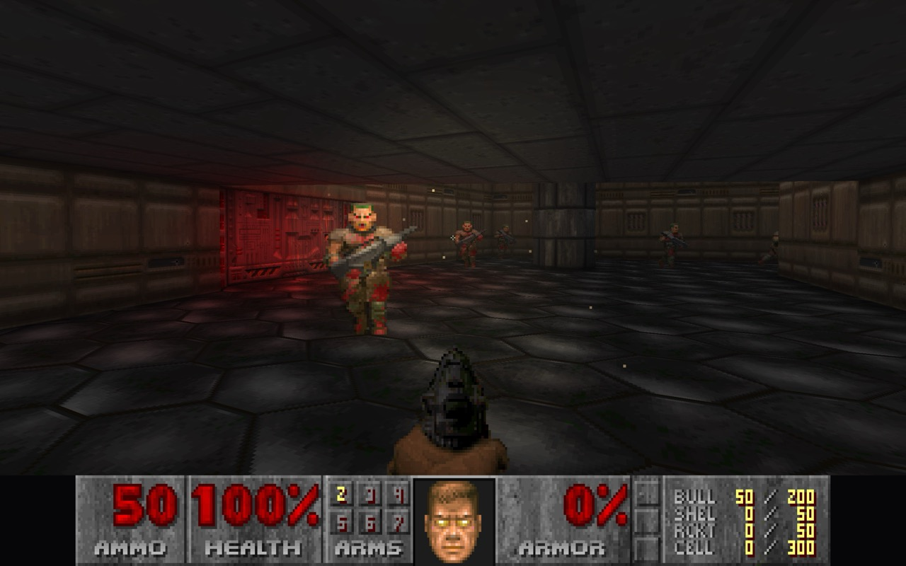
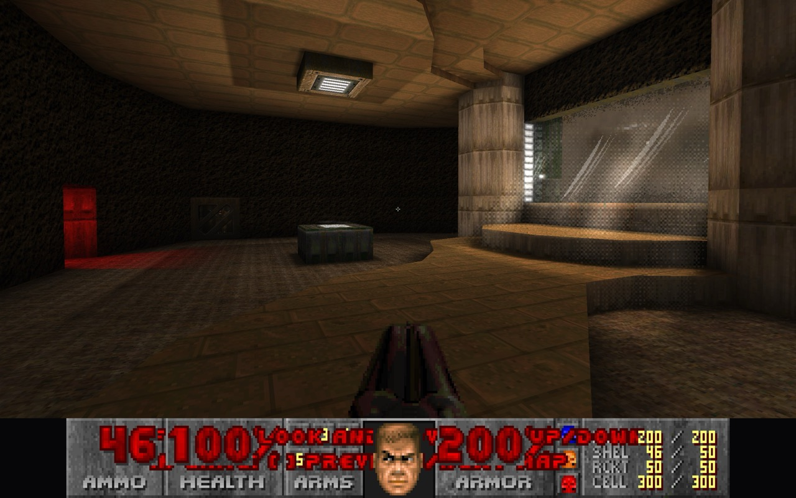
</p>

See
[`platform/scene3d/bake_lights.cpp`](platform/scene3d/bake_lights.cpp),
[`platform/emissive.h`](platform/emissive.h) and
[`platform/surface_lighting.h`](platform/surface_lighting.h).

### Static light is baked when a level loads

The bake works on DOOM's 2D map and is much simpler than a modern offline
lightmap. It gathers light from lamps, glowing textures and liquids,
decorations, windows and the sky, with walls and closed portals blocking it.
It adds one bounce, sky fill, sun shadows, ambient occlusion in corners and
under ledges, and shadows from decorations such as columns, trees and hanging
bodies.

The result can be snapped to the texture grid, so the light changes in steps
of DOOM texels.

Doors, lifts and lowering walls re-light the area around them as they move, so
light spreads under an opening while it opens.

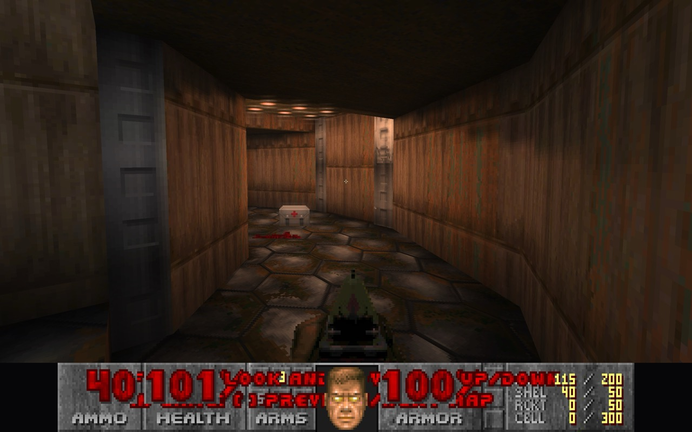

See
[`platform/baked_lighting.h`](platform/baked_lighting.h) and
[`platform/scene3d/relight.cpp`](platform/scene3d/relight.cpp).

### Bump and gloss come from the original pixels

World textures need no normal maps or material definitions. The renderer reads
surface relief from the artwork. Broad brightness structure becomes panel
seams, mortar and grooves, and small noisy changes are softened, so a riveted
ceiling catches light along its seams while painted specks stay flat.

The palette ramps give a rough material guess. Greys and blues lean toward
metal and greens toward wet or polished surfaces. Browns, flesh and most stone
colors stay fairly matte. With varied highlights switched on, smooth artwork
gets tighter reflections than busy artwork.

It is a rough guess meant to make the existing art react to light. There is no
attempt at physically based materials.

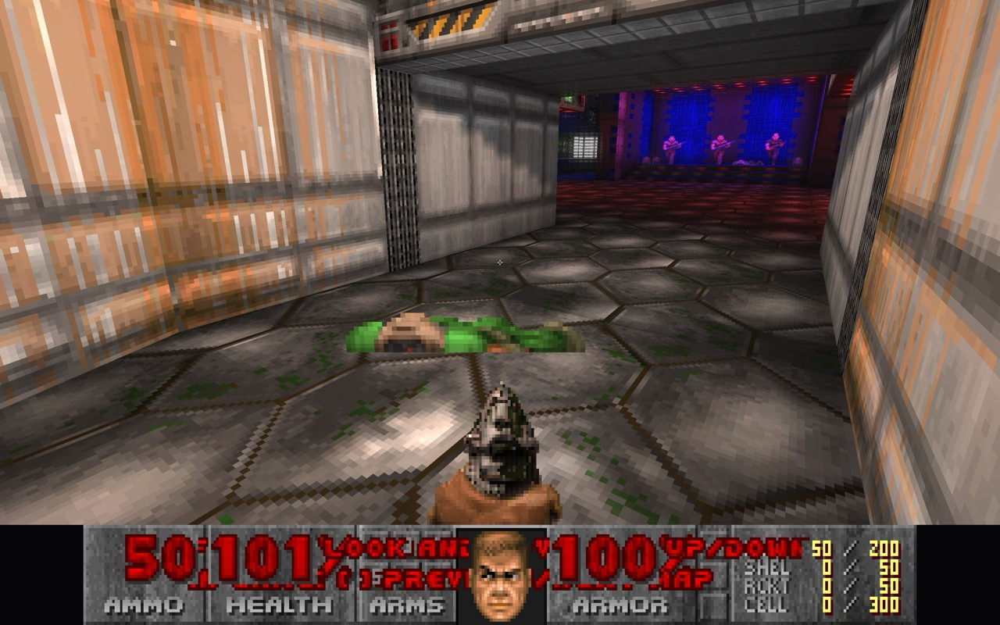

See
[`platform/scene3d/images.cpp`](platform/scene3d/images.cpp) and
[`platform/shaders/world.frag`](platform/shaders/world.frag).

### The weapon sprite is de-lit and lit again

The weapon is still the original 2D sprite, with no model behind it.

Before drawing it, the renderer removes part of the broad light and painted
sheen in the artwork and keeps the outlines, detail and the palette's color
ramps. It builds rounded normals from the silhouette and painted shading, and a
gloss map from highlights and metal-like colors.

The shader lights the sprite from lamps, muzzle flashes and the room around the
player. Six directional probes stand in for the surroundings, so bright walls
and windows show up on glossy metal and the top of a barrel can catch a lamp
ahead.

See
[`platform/weapon_lighting.h`](platform/weapon_lighting.h),
[`platform/scene3d/weapon.cpp`](platform/scene3d/weapon.cpp) and
[`platform/shaders/world.frag`](platform/shaders/world.frag).

### Monsters are lit as rounded bodies

When a sprite loads, each pixel of its silhouette rises as a tube as wide as
the largest disk that fits inside the outline at that point. The torso becomes
a broad cylinder, and arms, legs and guns become thinner ones. Light falls on
that shape, and the painted shading stays visible on top.

<p>
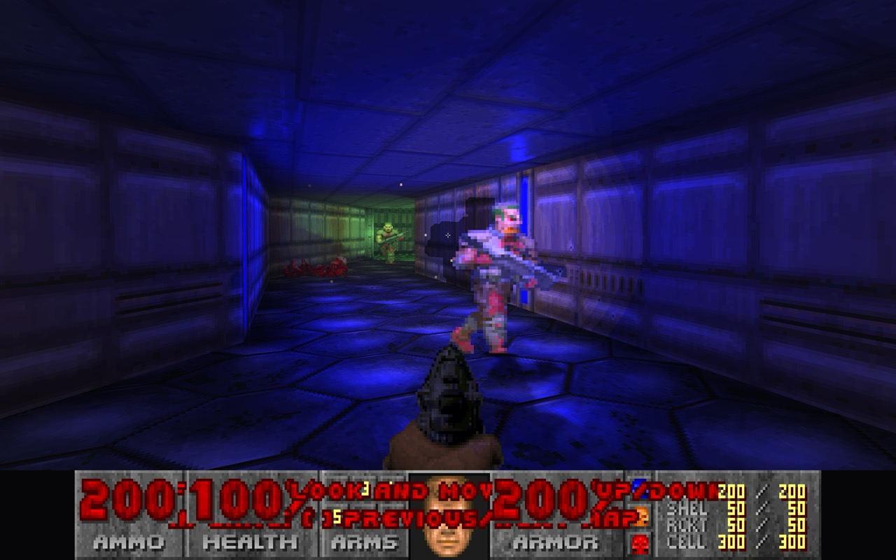
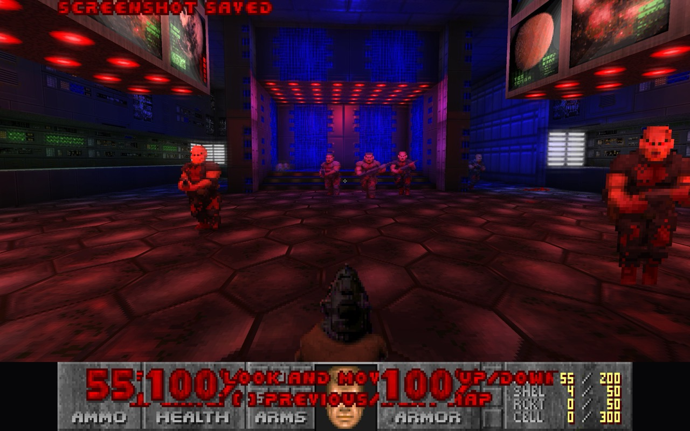
</p>

See [`platform/scene3d/sprite_normals.cpp`](platform/scene3d/sprite_normals.cpp).

### Shots and explosions light in their own colors

The color of a dynamic light is sampled from the sprite that makes it. Bright
saturated pixels count, and transparent outlines and white cores are ignored.
A plasma shot casts blue light because the plasma sprite is blue. The same goes
for weapon flashes, enemy attacks and glowing projectiles. Walls, doors, raised
floors and other map geometry block this light.

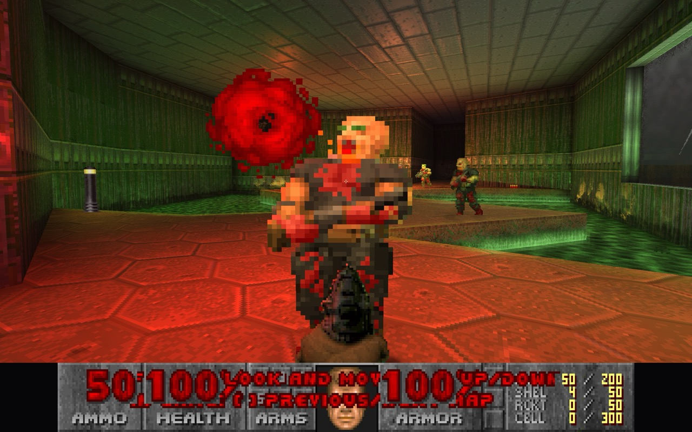

See [`platform/flash_lighting.h`](platform/flash_lighting.h).

### The flashlight sits at the shoulder

The flashlight is mounted at the player's right shoulder, a little behind the
eyes as in Doom 3. It lights the floor ahead from above, and wall edges, door
frames and things cast visible shadows. It pulls back out of walls the player
is pressed against and sways with DOOM's weapon bob.

The classic beam, which is the default, brightens in DOOM's light-level steps.
With the classic option off, the beam bounces a soft light in the color of
whatever it hits, so a lit wall spills onto the dark floor in front of it.

Dynamic light also pushes saturated colors toward its own hue, the way the
palette ramps brighten, so dark blue carpet shows the beam. What it adds rolls
off on bright texels, so a lit wall doesn't get far ahead of the dark floor
next to it.

See [`platform/scene3d/lights.cpp`](platform/scene3d/lights.cpp) and
[`platform/scene3d/exposure.cpp`](platform/scene3d/exposure.cpp).

### Shadows are squashed sprites

A monster's shadow is its current animation frame flattened onto the floor as a
dark translucent decal, clipped to the sector's floor polygons. It spreads and
fades when the monster rises into the air. Monsters get a second flattened
shadow pointing away from the strongest dynamic light nearby.

The flashlight can throw hard-edged sprite silhouettes onto walls, and the
player can cast a shadow from the sun or the strongest suitable light.

See [`platform/scene3d/shadows.cpp`](platform/scene3d/shadows.cpp).

### Monitor textures get fake curved CRT glass

Computer textures are searched for dark rectangular screens framed by lighter
housing. Vent grilles and similar shapes are rejected.

No geometry is added. The world shader puts a curved normal over the flat
texture, bends the picture a little like a weak lens, darkens the rim and lets
dynamic lights slide across it as a highlight on the glass.

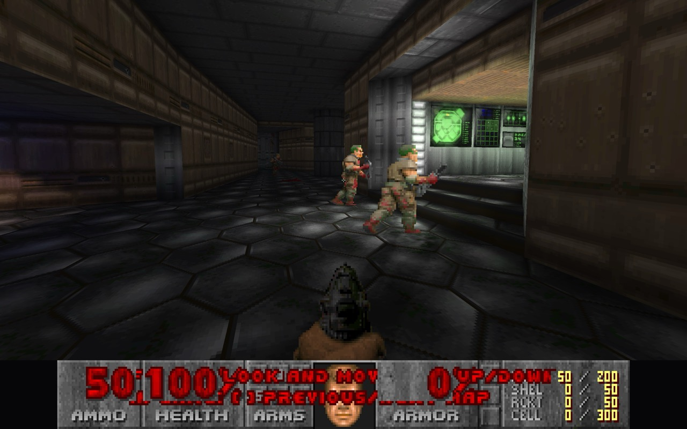

See [`platform/screen_glass.h`](platform/screen_glass.h).

### Water reflects the room

When water is visible near the player, the nearest visible water level becomes
a mirror plane and the world is drawn again at half resolution from a camera
flipped across it. The water shader distorts that image with simple waves and
with the brightness changes in the animated water flat, so DOOM's own texels
break up the reflection. Nukage, slime, blood and lava are left without
reflections on purpose.

The optional retro reflection mode draws the mirror at one-eighth resolution
with nearest-neighbour pixels and maps the result back to the WAD palette.

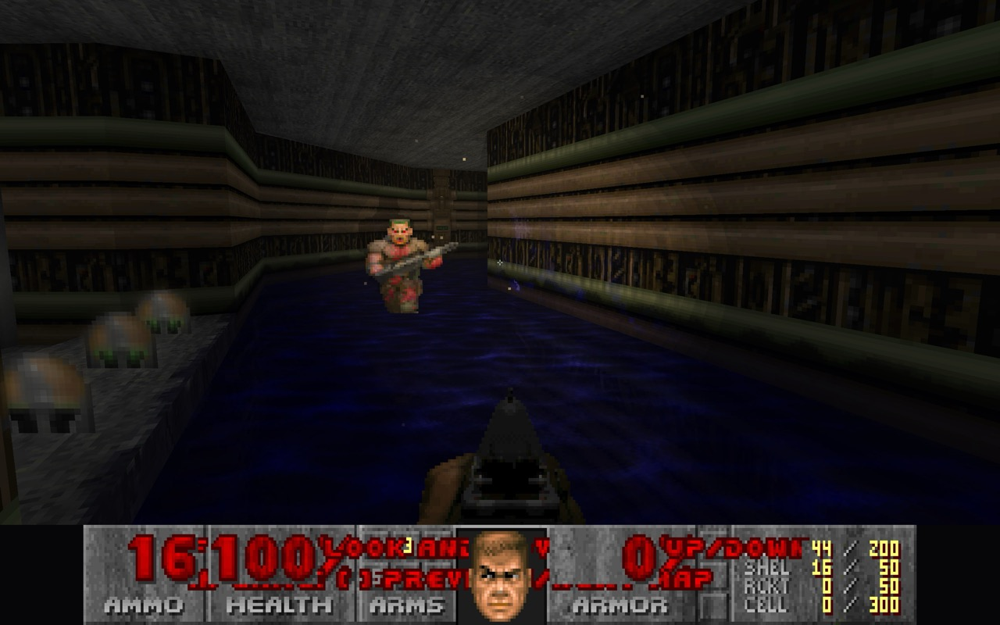

See
[`platform/gpu3d/frame.cpp`](platform/gpu3d/frame.cpp),
[`platform/scene3d/geometry.cpp`](platform/scene3d/geometry.cpp) and
[`platform/shaders/world.frag`](platform/shaders/world.frag).

### Liquids affect what's around them

Liquid flats can throw moving caustics onto nearby walls and, optionally,
ceilings. The pattern is taken from the level's own liquid artwork. Banks just
above liquids that aren't hot can darken as if damp.

Bullets hitting liquid throw palette-colored drops and expanding rings, and
things landing or wading in it disturb it too. Nukage, slime, blood and lava
act heavier, with slower rings, bigger drops, bubbles and a wobbling collar
around anything standing in them. Water is lighter and quicker. The particles
are chunky DOOM-sized blocks.

<p>
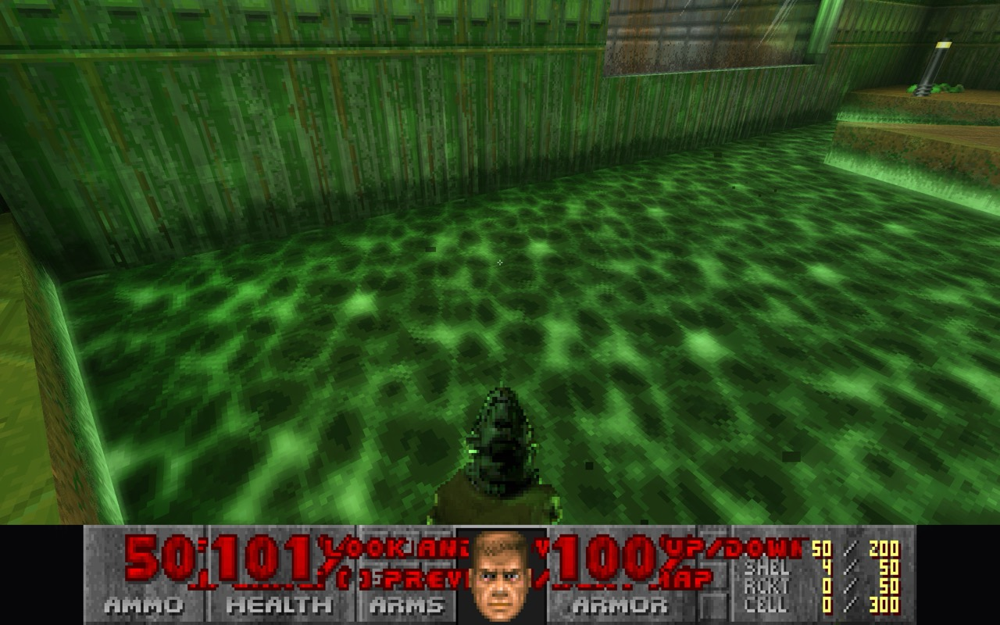
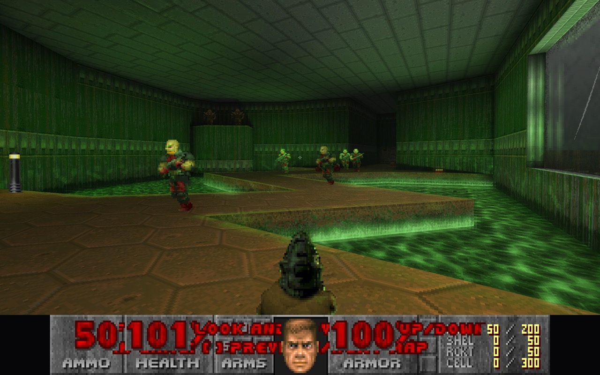
</p>

See [`platform/scene3d/liquids.cpp`](platform/scene3d/liquids.cpp),
[`platform/scene3d/caustics.cpp`](platform/scene3d/caustics.cpp) and
[`platform/shaders/world.frag`](platform/shaders/world.frag).

### Windows are found in the map and glazed

DOOM maps have plenty of windows but no glass. When a level loads, the renderer
looks for them in the geometry: a thin sector between two others, with a sill
and a lintel, that the player can't walk into. Lifts, doors and anything a
switch moves are skipped. The DOOM episodes have about a hundred of these
windows, DOOM II about eighty.

Each window gets a pane over the opening. It is mostly clear, with grime
collected at the frame and on the sill, a few shine streaks painted on the way
Duke Nukem 3D did its glass, and sharp highlights from lamps, muzzle flashes and
the flashlight.

The game code doesn't know the glass is there. Shots, sight and movement pass
through exactly as in vanilla, so the renderer watches for anything crossing a
window. A render-only hook reports hitscan shots crossing a line, and
projectiles and explosions are checked every tic. The first thing through
shatters the window into palette-colored shards that fall, bounce and lie on
the floor for a while, leaving a jagged rim in the frame. Monster shots count
too, so a fight across a window breaks it.

<p>
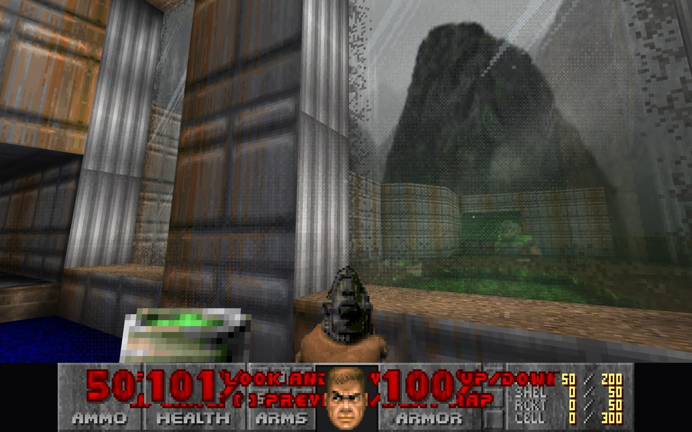
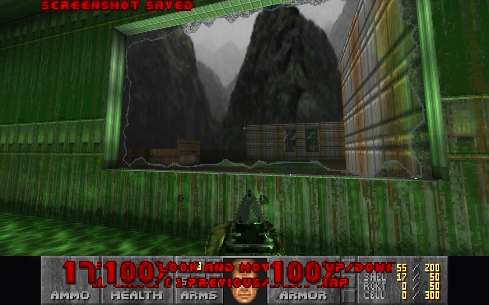
</p>

The window the player is looking at reflects with the same mirror trick as the
water, so walls, lamps, monsters, shots and the player's own sprite all appear
in it. Sprites are turned around for the mirrored view, so a monster coming up
from behind shows its face in the glass.

Every other window shows a snapshot: a small cube map taken in front of it
after the level's lighting has baked, holding only the map. The reflected ray
is projected onto a box around the room, so nearby walls stay put as the player
moves. When the view turns to another window, it fades from its snapshot to a
live reflection.

How strongly the reflection shows depends on contrast. Bright things in it are
visible and dim walls stay faint, so the window stays see-through.

<p>
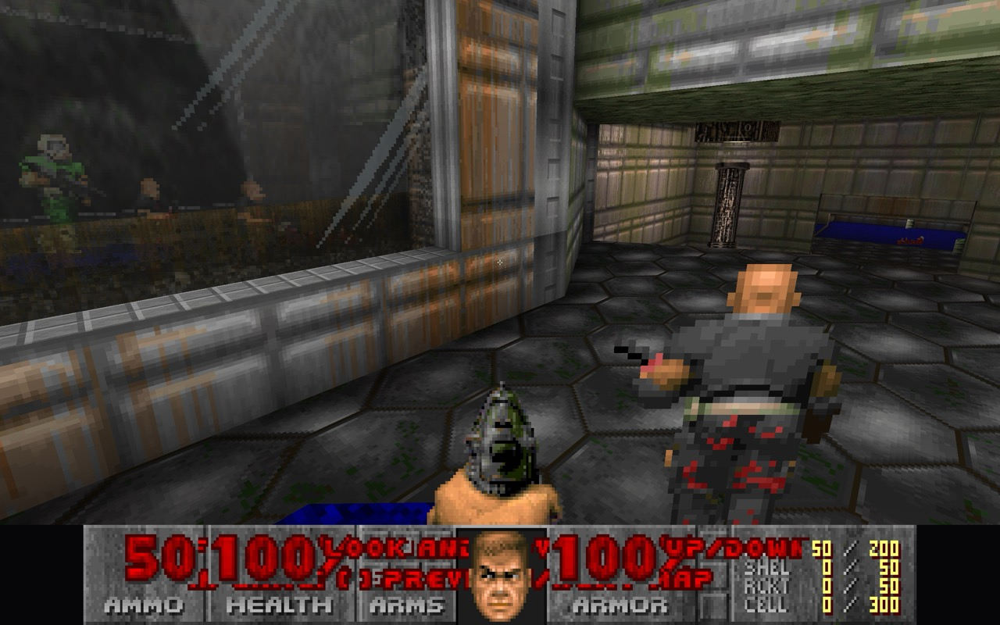
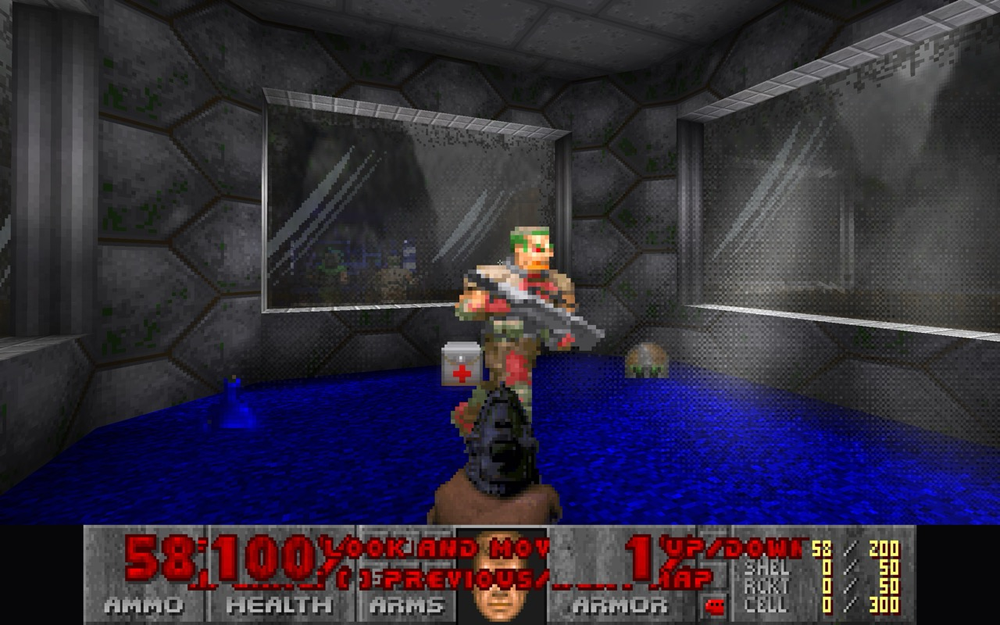
</p>

See [`platform/scene3d/windows.cpp`](platform/scene3d/windows.cpp) and
[`platform/shaders/glass.frag`](platform/shaders/glass.frag).

### Fog, mist and sunbeams are simple fakes

Distance fog is an exponential formula with no raymarching. Pits, liquids and
damaging floors can carry low cloud-like layers of mist. Sunlit openings can
cast simple light shafts back toward the sun, with dust motes showing only
where the sun or flashlight catches them. Hot floors and flames create small
heat volumes, which a screen pass turns into a sideways shimmer that steps with
the game tics.

The sun's position is inferred from the level's sky lighting. It can be drawn
in the sky, optionally with forward scattering.

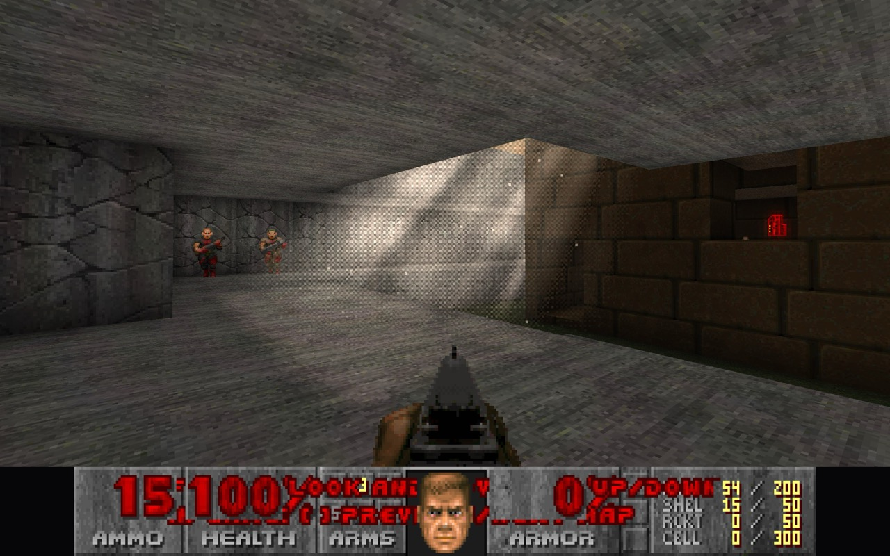

See
[`platform/volumetric_fog.h`](platform/volumetric_fog.h),
[`platform/scene3d/atmosphere.cpp`](platform/scene3d/atmosphere.cpp),
[`platform/shaders/mist.frag`](platform/shaders/mist.frag) and
[`platform/shaders/present.frag`](platform/shaders/present.frag).

### Blood is made from the WAD too

Hitscan attacks can leave splats on floors and walls, and corpses slowly grow
pools beneath them. The decals are generated at runtime from colors sampled
from the WAD's blood sprites. Fresh floor blood catches dynamic highlights and
then dries darker and matte. Pools grow in visible steps.

Bullet impacts leave marks as well and throw small chunks colored like the
surface they hit.

See [`platform/scene3d/blood.cpp`](platform/scene3d/blood.cpp) and
[`platform/scene3d/impacts.cpp`](platform/scene3d/impacts.cpp).

### Pixel art stays sharp

The renderer draws at the display's native resolution and can keep the
textures sharp. World textures can use nearest filtering, plain bilinear, or a
sharp-bilinear mode that keeps the middle of each texel flat and softens only
its edge. Palette-aware mipmaps reduce shimmer in the distance.

Sprites can stay nearest-neighbour or use soft bilinear filtering.

An optional final pass quantizes the whole image back to the current WAD
palette, including lighting, fog and bloom.

Animated walls and flats crossfade between their frames. Doors, lifts, sprites
and the camera are interpolated between DOOM's 35 Hz game tics.

## How the sound cheats

Sound gets the same treatment as the graphics. Everything is worked out from
the map while you play, and the original effects are still mixed as crunchy
8-bit samples. The target is a late-90s A3D or EAX sound card, with a fairly
short and lo-fi reverb. Music stays dry. The settings are in the **Sound** tab
of the F4 panel.

### Rooms are measured with rays

Every other tic, 32 rays go out from the player across the map in a flat
circle. A ray stops at a one-sided wall or at an opening too low for sound,
such as a closed door or a raised lift. Rays that leave through open sky don't
come back.

The rays give the distance to the walls and also sketch the floor plan. That
plan, the ceiling heights the rays crossed and how much of it is open sky give
a room volume for Sabine's reverberation formula. The result is squeezed into a
game-like range: corridors slap back, big halls boom and outdoors stays almost
dry.

WADs have no material data, so materials are guessed from texture names.
`STARTAN`, `COMP` and `METAL` ring like metal, `WOOD` and the panel textures
sound dull, and flesh, liquids and dirt each absorb sound differently. Anything
else counts as stone.

### Echoes and a reverb tail

The rays are grouped into eight directions around the player. Each group makes
one echo, delayed by the round trip to its walls and panned by where they are
relative to the way the player faces. A ninth echo comes off the ceiling.

A small feedback delay network makes the late tail: eight damped delay lines
mixed through a Householder matrix. Metal rooms keep their treble and wooden
ones lose it. When the room changes, the echoes crossfade and the tail glides
over a third of a second, so walking through a door doesn't click.

Far sounds send more to the reverb relative to the dry mix, so they sound
further away as well as quieter.

### Walls muffle, distance dulls

Each positioned sound has its own two-stage lowpass filter. The cutoff is set
when the sound starts and updated every other tic while the sound or the player
moves.

- **In sight:** only distance removes treble, from about 200 units out to
  DOOM's clipping distance.
- **Around a corner:** if the sound has an open path to the player, through an
  open door, over a ledge or through a window, it is muffled a little. The
  search follows short routes through connected sectors.
- **Sealed off:** with only closed doors and solid walls in between, it is
  muffled heavily.

Muffling only changes the tone. Volume is the same as in vanilla DOOM, so you
can locate monsters by ear as well as before.

The mixer uses DOOM's 0–15 effects volume scale and DMX-style panning. A peak
limiter briefly ducks the mix when many shots fire at once, so it doesn't
crackle.

See [`platform/audio/room.c`](platform/audio/room.c),
[`platform/audio/reverb.c`](platform/audio/reverb.c),
[`platform/audio/occlusion.c`](platform/audio/occlusion.c) and
[`platform/i_sdl_sound.c`](platform/i_sdl_sound.c).

## Game data

This repository contains **no commercial game data**. To build and play from
source you need an IWAD:

- **Freedoom** (free): download `freedoom1.wad` or `freedoom2.wad` from
  [freedoom.github.io](https://freedoom.github.io/).
- **Original DOOM / DOOM II** (commercial): use the `.wad` files from a copy
  you own, for example from Steam or GOG.

Please don't commit or upload commercial WAD files to this repository.

## Build

You need CMake 3.21+ and a C11/C++17 compiler (Apple Clang, Clang, GCC or
Visual Studio 2022). SDL3 is downloaded automatically if it isn't installed.

```sh
cmake -S . -B build/play -DCMAKE_BUILD_TYPE=Release -DDOOM_BUILD_SDL=ON \
  -DDOOM_GAME_DATA="/absolute/path/to/freedoom1.wad"
cmake --build build/play --parallel
ctest --test-dir build/play --output-on-failure
```

## License

Copyright © 2026 Robert Heidenreich. Licensed under the GNU General Public
License version 3 ([`LICENSE.TXT`](LICENSE.TXT)), with one additional term
under section 7(b): redistributions and derivative works containing the
original Duct-Tape DOOM contributions must preserve the attribution
"Duct-Tape DOOM — https://github.com/robongrui/duct-tape-doom". The full
notice is in [`NOTICE.txt`](NOTICE.txt).

The DOOM source by id Software, which this is built on, is GPL version 2 or
later. [`THIRD_PARTY.md`](THIRD_PARTY.md) lists it and the libraries and data
that come from elsewhere, with their licenses.
